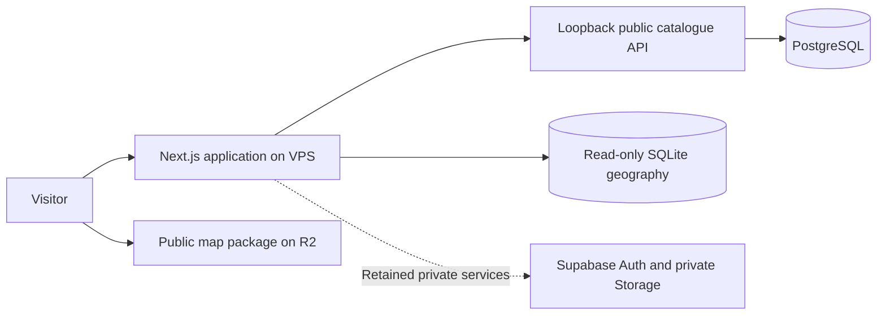

# Hisaab architecture

Current architecture: 31 October 2026. This guide describes responsibilities; account identifiers, addresses, credentials and private recovery records do not belong here.

## Public experience

`src/app/page.tsx` reads the approved catalogue and passes it to the public preview gate. The map application is loaded after entry. State and asset URLs resolve through the same atlas; URL state must survive refresh and browser navigation.

Public catalogue reads use `publicDb()`. A configured dedicated catalogue connection selects the VPS read API; otherwise development can use local Supabase. The API has restricted anonymous access. It does not expose the private schema or administrator credentials.

Historical assets use a separate read-only SQLite edition for card details, search and counts. Vector tiles, boundaries and summaries are served from an immutable R2 package. Preserve the matching manifest and shard names. Historical location records do not establish present-day condition or financial evidence.

## Review and private services

Source acquisition stages private candidates. Review checks identity, source meaning, geography, accounting, conflicts and reuse rights before creating a public snapshot. Publication and withdrawal safeguards live in SQL and must also survive application refactors.

Owner authentication and private-file services still retain Supabase dependencies. The public-data cutover is not a full private-service migration. While databases are split, `HISAAB_MIGRATION_READ_ONLY=true` pauses application writes. Keep that setting until the remaining migration checks pass.

## Repository responsibilities

| Directory | Responsibility |
| --- | --- |
| `src/app` | Next.js routes, page entry points and global styles |
| `src/features` | Feature-specific components and hooks extracted from the atlas |
| `src/components` | Existing UI and shared visual components; migrate incrementally |
| `src/lib` | Domain models, evidence rules, infrastructure and database access |
| `workers` | Source acquisition, parsing, normalization and Python tests |
| `scripts` | Local verification, intake, map packaging and operating tools |
| `supabase/migrations` | Ordered, applied schema and RPC history |
| `tests` | Unit tests and browser scenarios with synthetic fixtures |
| `data` | Versioned source registers and scoped acquisition summaries |
| `docs` | Current guides plus dated source research |

Private originals, runtime geography, backups and investigation workspaces remain ignored. A fresh checkout intentionally does not contain the full acquisition collection.

## Contribution boundaries

Keep route URLs and response contracts stable during refactoring. Feature modules may use shared infrastructure; shared infrastructure should not import feature UI. Avoid abstractions without a concrete second use or an isolation requirement. Extract responsibilities, not layers of forwarding functions.

Applied migrations are history, not files to reorganize. A proposed database change needs a new migration, disposable-copy rehearsal, permission tests and a rollback strategy. See [the database guide](database.md).

## Deployment and history

GitHub merges do not automatically deploy the VPS. Build and test a new release, retain the previous release, then promote and verify through a separate reviewed deployment. Map-package updates and data publication are separate operations.

Use [the VPS catalogue guide](vps-public-catalogue.md) and [Hostinger deployment guide](../deploy/hostinger/README.md) for current operating constraints. Older Netlify guides and dated acquisition/status documents are historical unless explicitly updated. They do not override this architecture or current evidence decisions.
