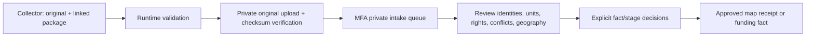

# Hisaab collector handoff

Approved rebuild · 11 October 2026 · contract `hisaab-intake/1`

The collector's job is to supply documentary evidence for an India → state → project receipt. The app and private review pipeline are implemented separately. Return records privately; collection does not authorize publication, new emails, paid access, RTI filing or bypassing access controls.

**Active scope update, 12 October 2026:** collect **FY 2025–26 and FY 2026–27 to source cutoff**, in the owner's 28-state order, starting Andhra Pradesh and ending West Bengal. Useful separately scoped budgets, reported expenditure, projects, sanctions, tender/award records and documented roles can be collected before a complete payment card exists. Earlier eleven-year funding and UT holdings remain preserved. See [current collection plan](state-development-collection-plan.md), [source methods](state-development-source-methods.md) and [checkpoint](state-development-collection-status.md). No older handoff overrides this scope.

## The facts each receipt needs

| App surface                | Required evidence                                                                                                                                                                                                              |
| -------------------------- | ------------------------------------------------------------------------------------------------------------------------------------------------------------------------------------------------------------------------------ |
| National/state funding     | Programme and budget head; financial year; government/channel/instrument; allocated, released or reported spent; exact source units; original/revised edition; reporting dates; actual jurisdiction; source locator.           |
| Development inside a state | Official attribution of works or expenditure to that area; Union/state/local contributions; documented joint shares; a non-overlap explanation before combining amounts. Keep transfers received separate.                     |
| Project                    | Official project/activity ID, title, development purpose, implementing agency, year, LGD state/district/locality identity. One asset may have multiple projects.                                                               |
| Location                   | Official coordinate/alignment/footprint or documented address, connected to the exact project ID. A district centre or nearby historic dot is insufficient.                                                                    |
| Sanction/contract          | Approval/amendment and agreement/work-order IDs, amounts, dates, contractor and scope. Preserve conflicting editions.                                                                                                          |
| Payment                    | Bill/transaction identity; exact project allocation; recipient identity and role; gross/deductions/net; each recorded date and its meaning; status; reversals and reissues. Treasury acceptance alone is not recipient credit. |
| Completion                 | Reported progress separately from a dated completion certificate/inspection. Before/during photos do not certify completion.                                                                                                   |
| People/media               | Documented official, agency and contractor roles, optional attributed public photos/site images. Cross-project history requires official identity or a documented crosswalk. No name-only merging.                             |
| Coverage                   | Official denominator if available, exact source filters/years/pages, missing fields, blockers, custodian and restart checkpoint. Unknown is not zero.                                                                          |

Do not collect bank accounts, Aadhaar, passwords, authentication secrets or unnecessary private details. A public contractor role does not establish corruption or justify inventing a photograph.

## Four acquisition routes, pursued together

1. **Official public reports.** First inspect the existing preserved source and checkpoint. Use visible permitted reports and documented APIs. Collect useful separately scoped evidence even when the full ID → bill → allocation chain is missing; retain that missing link explicitly. Prove a complete chain before claiming complete project payment coverage. Preserve each original, date, filters, exact units and SHA-256. Stop a failing scope rather than retrying indefinitely or collecting unrelated rows.
2. **Authorized exports/APIs.** Seek a small sample from the accounting custodian: work register, agreement register, bill allocations, payment register, location references, accounting definitions and reuse terms. An institution transfer or support reply alone does not establish a project payment. Use explicit scope/update arrangements before scheduling ingestion.
3. **Targeted RTI drafts.** Name exact projects, package IDs and missing existing records. Identify central versus state/local filing jurisdiction. Prepare precise drafts; the user supplies applicant information and handles submission/payment. Preserve the response and assess what it proves.
4. **Agency pilot drafts.** Request records for named works from the responsible engineering/accounts unit, including split payments and correction contacts. Prepare outreach; new recipients require specific send authorization. Informal assurances are not documentary proof.

For department requests, the accepted plan calls for a substantive follow-up after seven working days and targeted escalation after fourteen. Do not send a follow-up merely because a draft or reminder exists. CAPTCHA help and access restrictions belong in the checkpoint.

## Source methods and starting priorities

These are acquisition instructions, not claims that every source exposes all fields in every state. Verify the actual report, field definitions, access basis and coverage before using it.

| Source family            | Method / join to prove                                                                                                                                                                     | Existing starting point / limit                                                                                                                                                       |
| ------------------------ | ------------------------------------------------------------------------------------------------------------------------------------------------------------------------------------------ | ------------------------------------------------------------------------------------------------------------------------------------------------------------------------------------- |
| PMGSY/OMMAS roads        | Road/package ID → sanction and agreement → bill allocation → dated recipient payment → source alignment. Reconcile unit definitions and amended sanctions.                                 | Ten Odisha financial rows; 7,161 proposed geography matches. Eight sanction conflicts and missing individual payments remain unresolved. Do not repeat completed identity pagination. |
| Odisha PPMS              | Exact project and bill IDs → permitted bill documents/component reports → named payee and allocated gross/net → source photo coordinate. Preserve all editions.                            | Balangir has 155 exact project/bill dossiers, 795 photo locations and assessed supporting links. Source photos are not certified sites; arithmetic matches are not settlement.        |
| eGramSwaraj              | LGD panchayat + FY + activity ID → approved action plan/work progress → voucher/cashbook allocations → payment semantics/location.                                                         | Begin with the best-evidenced Odisha pilot and supervised exports already downloaded. Activity and account reports are separate; prove voucher allocation.                            |
| MGNREGA                  | Official work code → work register/geography → muster/wage or material bill → FTO/payment allocation/status.                                                                               | Inspect permitted national/state MIS and exports. Wages/materials/transfers differ; protect personal identifiers. Do not assume a paid wage establishes a construction contract.      |
| MPLADS                   | Official work and sanction IDs → implementing agency → bill/payment references → location/completion.                                                                                      | Default both-house reports are collected. Current aggregate expenditure and scheme transfer data are insufficient for a complete project receipt.                                     |
| State/local public works | Division work register → administrative/technical sanction → tender/award → agreement → measurement/bill/allocation → treasury/recipient evidence.                                         | Delhi SER-2 and NCRTC dossiers already exist. A tender search or bid PDF is not a payment register. Establish full division denominator before saying a division is complete.         |
| Union/state funding      | Individual development line → allocation/release orders or parliamentary annexures → state attribution → utilisation/actuals. Reconcile original/revised editions and parent/child scopes. | 69,039 private budget rows and 86 published PIB disaster-funding facts. Ministry totals include non-development. Do not redistribute national totals by population.                   |

Use the repository source register and preserved request dossiers for exact known URLs and custodians. Do not replace a current endpoint with a guessed hidden route. For each additional jurisdiction, inspect its actual authority, accounting and procurement systems before writing an adapter.

## Collector return format

Files:

- `batch.json`: strict contract; up to 2 MB, 500 linked records, 30 sources and 100 projects/funding records per batch.
- `originals/`: unchanged source bytes, each with SHA-256 and lawful access/reuse basis. Current private original uploader accepts at most 10 MB per object. Larger official originals require an approved storage workflow; do not alter or split them while claiming the same checksum.
- `checkpoint.md`: completed scope/pages, errors, missing records, assistance needed and precise next action.

Use the generated [JSON schema](data-intake/hisaab-intake.schema.json), [36 prepared state/UT jobs](data-intake/state-jobs.json) and runtime validator:

```sh
npm run intake:validate -- /absolute/path/batch.json
```

The schema describes structural fields. Runtime validation also enforces identifier joins, exact source URLs/hashes, units, allocation limits, history cycles, jurisdiction/year agreement and the prohibition on agent approvals.

Top-level fields: `version`, `batchId`, `jurisdiction`, `cutoff`, `sources`, `projects`, `funding`, `assets`, `contracts`, `payments`, `allocations`, `parties`, `completion`, `coverage`. Optional record arrays default to empty. Use unpadded LGD codes such as `7` for Delhi, `18` for Assam and `21` for Odisha; `national` is allowed. The stable official identifiers need a source/system namespace.

### Field and accounting rules

- Every source has a unique `id`, HTTPS original `url`, `hash`, retrieval timestamp, content type, reuse basis and `storagePath` exactly `sourceId/sha256`. The owner uploads the original to the private bucket before staging.
- Every evidence reference repeats that exact URL/hash and gives a page/table/row/record locator. Rights are reviewed separately; accessibility alone is insufficient.
- `projects` uses the existing work model: four stages (`sanction`, `award`, `payment`, `completion`), source receipts, original units, unknown fields, proposed money. `approved` must be false; no `verified` review status from collectors.
- `assets` requires an exact project in the batch, official-ID/documented-crosswalk basis, source coordinate and precision. An archived asset ID must never be assigned by proximity.
- `payments` has stable official payment and bill IDs, original and normalized amount, recorded date/date basis, status, flow, amount basis, recipient role and history links. Missing dates stay null with `dateBasis: unknown`. A reversal is a documented negative adjustment. Gross minus deductions must equal net where all exist.
- `allocations` identifies payment, project, allocated amount/basis and official allocation reference. Shares cannot exceed the documented basis. Never copy the entire package payment to every road. Never combine gross and net shares in one total.
- `funding` separates `origin` (Union/state/joint/local), `scope` (within-area/received), measure, accounting basis and instrument. Joint shares reconcile exactly. `disjointEvidence` is null unless documentary non-overlap exists. It is not an assertion that collectors can approve.
- `parties` is documentary role evidence; public project `roles[].identityBasis` is needed for five-year cross-project history. Photos need a separate source/reuse record.
- `completion.basis` is reported or certificate; certificate IDs and dates remain null if absent.
- `coverage.denominator` needs a preserved official `denominatorSource`; otherwise null. Never treat collected row count as the total number of government works.

## Import and publication



Open `/admin/intake` with live owner MFA. Upload originals, validate/stage JSON, inspect components, prepare project review candidates and review individual facts through the owner console. Funding classification cannot modify original amounts or source identities. Publication still needs every evidence gate. Pending stages stay pending/missing; no automatic approvals.

The normalized component arrays are private dossiers. They do not automatically become money in `projects[].money`; collectors should also construct the proposed work stages/money/roles from their exact documentary joins. Preparing the queue copies that proposed work to review without approving it. Component-only batches remain useful evidence, but do not create public cards on their own. Corrected editions need reconciliation rather than overwriting earlier originals.

Current database intake has a hard 425 MiB capacity guard. When it rejects a package, retain files/checkpoints privately outside the database and arrange capacity/archival before retrying. Do not weaken the guard or enable a paid plan automatically.

## Reusable agent assignment

> Collect documentary development evidence for **[state and LGD code]**, **FY 2025–26 and FY 2026–27 to source cutoff**, following the owner's 28-state order. Read `docs/state-development-collection-plan.md`, `docs/state-development-source-methods.md`, `docs/data-acquisition-contract.md`, existing source/register/checkpoints and the strict intake schema first. Reuse completed acquisitions. Research this state's actual budget, accounts, departments and procurement systems; collect useful separately scoped allocations, expenditure, projects, sanctions, tender/award records and documented roles even where payments remain unknown. Pursue permitted official reports and documented APIs; prepare export, targeted RTI and agency-pilot requests for precise gaps without sending or filing them. Prove official project/location/contract/bill/recipient links before claiming a complete card; keep transfers, cumulative expenditure and individual payments distinct. Preserve originals, exact source decimals, date meanings, rights and conflicts. Return bounded `hisaab-intake/1` batches, original hashes/files, explicit missing fields, official denominator if available and a restart checkpoint. Keep all records private and unapproved. Do not fabricate links, infer settlement, bypass access controls, collect unnecessary banking/personal identifiers or claim complete statewide coverage without a reconciled denominator.

The job file retains 36 jurisdictions but marks the 28 states as the active ordered scope. The UT handoffs and existing Odisha/Delhi pilots remain preserved. These are prepared handoffs, not dispatched agents or verified statewide coverage. The actual first source pass is documented in the separate collection checkpoint.
