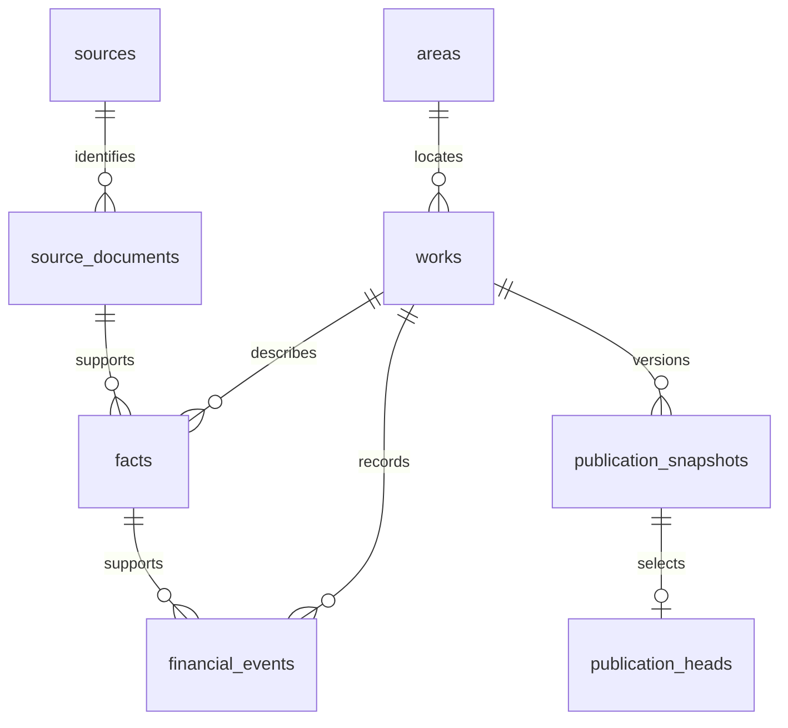

# Database guide

This guide describes the application schema, not a database export. [database-reference.json](database-reference.json) is generated from PostgreSQL catalogs after applying all checked-in migrations to a disposable local database. It includes columns, constraints, indexes, view definitions, function signatures/grants and policies. It contains no application rows, credentials or user records.

Regenerate it after an intentional migration:

```sh
npm run db:reference -- --container supabase_db_<disposable-project>
```

The generator only accepts a local Docker container name and reads catalog metadata. It does not connect to the production database. A review must still check generated output before publication.

## Evidence relationships



This is a conceptual map of the main evidence chain; consult the generated constraints for exact keys and nullable relationships. Publication snapshots preserve reviewed payloads and version/withdrawal behavior. A public schema object is not automatically permission for anonymous writes.

## Table responsibilities

| Group | Tables | Meaning |
| --- | --- | --- |
| Geography | `areas`, `area_crosswalks`, `lgd_registry_editions`, `lgd_registry_members` | Geographic identities, current registry editions and reviewed crosswalks |
| Sources | `sources`, `source_documents`, `source_permission_reviews` | Source identity, preserved-original hashes, locators, editions and rights review |
| Project evidence | `works`, `facts`, `financial_events`, `authorities`, `match_decisions`, `flags` | Project identities, individual supported claims, money events and reconciliation |
| Acquisition | `ingestion_runs`, `ingestion_candidates`, `candidate_revisions`, `candidate_import_editions`, `compacted_candidate_editions`, `atlas_batches` | Private staging, revisions, immutable editions and bounded batches |
| Publication | `publication_snapshots`, `publication_heads` | Published versions and the currently selected snapshot |
| Finance | `budget_context`, `funding_records`, `funding_decisions`, `funding_publications`, `funding_budget_lines`, `funding_budget_interpretations`, `funding_budget_drafts` | Budget/programme context, accounting interpretation, review and publication |
| Development | `development_drafts`, `development_decisions`, `development_publications` | Additional state development evidence and its review/publication state |
| Private reporting | `private_cases`, `case_events`, `case_media`, `case_attachments`, `case_videos`, `corrections`, `complaint_packets`, `complaint_routes` | Private observations, evidence transport, corrections and routing |
| Operations | `admin_members`, `audit_events`, `request_limits`, `ai_runs`, `coverage_cells` | Owner access, audit trail, operating limits and scoped coverage |

Public metadata includes geography, sources, coverage and selected publication surfaces. Most source candidates, decisions and case data live in `private`. Provider-managed `auth` and `storage` schemas are separate and are deliberately excluded from the public reference.

## Access paths and contracts

- `catalogue_page`, `catalogue_summary`, `catalogue_map` and `published_work_receipts` expose reviewed project information. The application validates published work payloads before rendering them.
- `funding_records`, `funding_history` and `development_records` expose reviewed accounting scopes. Their values are not automatically project payments.
- Owner RPCs require protected membership and verified MFA/session checks. Private ingestion uses a distinct privileged path. Anonymous callers must not inherit either capability.
- Private cases use capability tokens and encrypted payloads; attachment and media access must remain scoped to the correct case. Never place real case data in fixtures.
- Review the exact signature, security mode and grants of every function in the generated reference. For definer functions, also inspect the latest body in migration history: privileges alone do not establish authorization safety.

The application contracts are in `src/lib/model.ts`, `validation.ts`, `funding.ts`, `development.ts` and `intake-contract.ts`. The generated intake JSON schema is in `docs/data-intake/`. SQL checks, application validation and fixtures must agree; do not casually merge separate accounting concepts into one generic amount.

## Lifecycle and invariants

1. Acquire and preserve an original with its source identity, checksum, retrieval information and reuse basis.
2. Parse candidates privately, retaining source IDs, exact units and locators.
3. Reconcile project and geography identities; preserve ambiguous and conflicting evidence.
4. Review each claim and publication prerequisites, including rights and source validity.
5. Create a reviewed publication snapshot. Read APIs expose the permitted current version.
6. Withdraw or supersede through the supported workflow. An older withdrawn claim must not silently reappear.

An asset may have multiple projects. A sanction is not a payment. A transfer is not proof of recipient settlement. Source review is not physical inspection. Missing amounts remain null/unknown rather than zero.

JSON payloads preserve original/edition information and published receipts. Their presence is not by itself a reason to normalize every field into a new table. Propose structural changes only after showing a concrete integrity or query problem and a compatible migration.

## Testing and production boundary

Apply migrations from scratch to a disposable local project. Run the security/publication scripts listed in CI, plus unit and browser tests. Verify anonymous denial, password-only denial, MFA/membership behavior, source withdrawal, immutable editions, exact amounts and private-file isolation.

Public production reads now use VPS PostgreSQL through a restricted local API. Historical geography remains a separate read-only SQLite edition; map objects live on R2. Retained Supabase authentication/private services are not fully migrated. Preserve the application write pause during this split.

Never rewrite applied migrations, reset a database containing work, or run destructive test helpers against production. Database copies used for development must be separate from the database now serving public reads. Schema refactoring and private-service migration require their own design, rehearsal and rollout.
