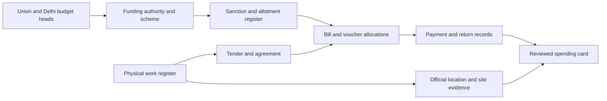

# Delhi: a testable route to complete spending cards

Accepted 9 October 2026, with the owner directing coverage across all Delhi authorities and divisions. This is the active Delhi evidence-acquisition scope; it does not declare complete coverage, replace the preserved Odisha evidence, authorize fees/RTI filing or resume the paused automation. The separate SER-2 ordinary email request was specifically authorized and sent on 9 October 2026.

## Decision

Work from a bounded register of funded works, then locate those works. Do not start by requiring financial cards for every historical map asset. The realistic first completion claim is a named implementing division, defined work types and fiscal period, with an official denominator. Whole Delhi remains a multi-authority target until every included authority passes the same test.

Start by testing South East Road Division 2, Delhi PWD, using the current public eMonitoring project/tender/agreement chain. Fixed initial accounting periods: closed FY 2025–26 (1 April 2025–31 March 2026) and FY 2026–27 through 9 October 2026 (1 April–9 October 2026). Request separate full civil-road/foot-over-bridge work and bill/payment registers, contracts open at each year start, carried liabilities, unpaid/cancelled works and division transfers. These are requested register scopes, not a claim that all matching works are identified. Preserve any broader original register and stored work-type fields. Earlier contracts and their opening balances are included; the original longer historical objective remains a later backfill, not completed by these two periods.

## Sources newly checked

| Route                                                                                                                                                   | Observed evidence                                                                                                                                                                                                    | Limit                                                                                                                                                                                                         |
| ------------------------------------------------------------------------------------------------------------------------------------------------------- | -------------------------------------------------------------------------------------------------------------------------------------------------------------------------------------------------------------------- | ------------------------------------------------------------------------------------------------------------------------------------------------------------------------------------------------------------- |
| [Current Delhi eMonitoring](https://www.emonitoringdelhi.in/project-work)                                                                               | Normal public UI showed 45,133 registered work results with department unspecified and work type/status/category All; no date filter. Detail modals include project, tender, agreement, award and contractor fields. | Not an asset census or verified payment coverage; no current public payment feed established.                                                                                                                 |
| [Current PWD work report](https://www.pwddelhi.gov.in/project-work-report)                                                                              | Initial default UI showed 10,979 entries, with descriptions, dates, cost, contractor and status.                                                                                                                     | Rows are not proof of all PWD works; overlap with eMonitoring is unresolved. Do not add the counts.                                                                                                           |
| [Delhi procurement](https://govtprocurement.delhi.gov.in/nicgep/app?page=Fron)                                                                          | Tender/award lookup and references can provide agreement and work descriptions.                                                                                                                                      | Tender estimate, winning bid and contract award are not actual payment.                                                                                                                                       |
| [Delhi Principal Accounts Office](https://coa.delhi.gov.in/pao/software-implemented)                                                                    | Official documentation identifies bill/payment accounting and PWD/I&FC self-drawing DDO treatment.                                                                                                                   | Internal workflow documentation is a custodian lead, not public vendor-payment access.                                                                                                                        |
| [MCD North audit 2018–19](https://mcdonline.nic.in/portal/downloadFile/audit_report_for_the_year_2018-2019_of_ndmc_220804082655855_220805102047847.pdf) | PDF page 79 / printed page 68 explicitly ties four work-order references to release amounts and dates. For WO 7 dated 25 June 2013, order amount ₹324,840 and released amount ₹323,202 dated 30 January 2018.        | Historical audit context must remain; recipient and exact work geometry not established by that table. Neither amount is automatically an approved payment.                                                   |
| [MCD South audit 2018–19](https://mcdonline.nic.in/portal/downloadFile/audit_report_for_the_year_2018-2019_of_sdmc_220804082733833_22080510200282.pdf)  | PDF pages 62–63 identify Dhansa drain/road work, Ganika Associates, WO461 dated 8 January 2018, contract ₹557,103 and payment released ₹557,103.                                                                     | Project-level released amount, not a dated transaction. Audit objection and historical ward identifiers must remain.                                                                                          |
| [CAG Delhi transaction audit](https://cag.gov.in/uploads/old_reports/state/Delhi/2007/Commercial/Commercia_Delhi_2007/vol_1chap4.pdf)                   | A historical DJB case connects named vendor, contract and dated final-bill payment narrative.                                                                                                                        | Historical/selected cases cannot establish current whole-city coverage. Main-worker download timed out; separate researcher inspected official bytes. Do not count it as a privately preserved original here. |

Web text fetching returned 403 for current PWD/eMonitoring pages, while normal browser UI opened publicly. No protection was bypassed. Search-indexed legacy WorkCSR payment pages redirect to the redesigned homepage in the current browser. Do not build a collector around cached search results or claim that legacy payment feed still works.

## Actual current diagnostic project

Public eMonitoring project PWD-2026-5557 belongs to South East Road Division 2 and concerns structural repair of a foot-over bridge. It displays:

- Tender 2026_PWD_296167_1, reference 58/EE/SER-2/PWD/2026-27.
- Agreement 55/EE/SER-2/PWD/2026-27; contractor F.Z. BUILDERS.
- Estimated ₹8.19 lakh, sanctioned ₹8.27 lakh, awarded ₹5.72 lakh on 13 August 2026.
- Reported physical progress 100%; financial expenditure N/A and financial progress 0%.

This proves a promising identity/contract chain, not a payment. Obtain the sanction original and amendment history, agreement/work order, running/final bills, payment register, deductions, payment/return entries and official site description. N/A and 0% do not establish zero payments. Source-reported physical completion does not establish a completion certificate. No exact coordinates verified.

Another diagnostic, M-2026-2848, has an award date later than its displayed start date. Preserve the conflict rather than choosing whichever date makes the story easier. A completed-status row with missing finances remains incomplete.

## Two-direction investigation

Arrows are records to obtain, not joins presumed from similar names. A general budget head may cover many unrelated projects. Use project-specific sanction, work/agreement and allocation identifiers to connect the two directions. When no allocation exists, retain the funding total at the programme/package level.

The [Union 2026–27 Demand 57](https://www.indiabudget.gov.in/doc/eb/sbe57.pdf) provides a named Chandrawal WTP capital provision of ₹380 crore. [Delhi demand 11](https://finance.delhi.gov.in/sites/default/files/Finance/generic_multiple_files/d-11_0.pdf), printed pages 485–486, distinguishes central-share loan-to-DJB head 6215 01 191 70 00 55 (₹380 crore BE) from state-share head 6215 01 191 69 00 55 (₹95 crore BE). Their sum matches the ₹475 crore plant/pipeline provision in [Delhi budget highlights](https://delhiplanning.delhi.gov.in/sites/default/files/Planning/highlights_of_gnctd_budget_2026-27_english.pdf). This is a budget-category reconciliation, not proof of actual transfers or vendor payment. Do not add ₹380 crore again to ₹475 crore. Ask for actual release, receipt/allotment and implementing-agency claim/bill ledgers separately.

## Execution and acceptance gates

1. **Establish the denominator.** Obtain the full division work register and bill/payment register for the chosen period, opening liabilities, scope/cutoff and a reconciliation/control total. Compare public projects, procurement awards and register entries. Log cancelled, unpaid, missing and carried-forward works. Do not define completeness from only the easiest public projects.
2. **Prove two chains.** Start with the named PWD diagnostic and another same-division work. Require official project/location, purpose, sanction amount/date, contract amount/date/business recipient, each project-allocated payment amount/date/basis and sources. Request the precise existing records from engineering and accounts custodians, not a general helpdesk request for an API. Treat recorded payment and bank credit as different evidence levels.
3. **Close gaps through alternative records.** Use award/board documents, municipal/CAG audits, existing disclosure tables and recorded inspection/certified-copy routes. Invite a contractor or agency to voluntarily supply minimized invoices, payment advice and relevant receipt evidence; reconcile those against agreement, bills and department records. A contractor statement, screenshot, plaque or news report alone does not establish government payment. Do not request credentials or entire bank statements.
4. **Complete the pilot register.** Once the two chains work, apply that process to every included work. Track location, purpose, sanction, contract, recipient, payment amount/date/basis, payment identifiers, reversals, cutoff and completion evidence separately. Missing facts remain missing; only a supported register/accounting assertion can establish that no payment was made. Reconcile all recorded in-scope payments, split shares, retentions, advances, returns and transfers without double counting. Request a custodian-produced periodic export if no public API is permitted.
5. **Publish a precisely named result.** After source/reuse, fact and owner MFA review, publish map cards and the register coverage denominator. Claim "all identified in-scope works and recorded payments reviewed for [division/type/period]" only after its register and reconciliation gate passes. Do not claim all Delhi assets, all historical spending or confirmed bank credit from that pilot.
6. **Expand Delhi authority by authority.** Repeat across PWD divisions, MCD zones, NDMC, DJB, I&FC, DUSIB and relevant central/other agencies such as DDA/CPWD/rail/metro authorities. Projects in Delhi are not necessarily funded by GNCTD. Establish an authority inventory and non-overlapping scope for each; one city boundary does not make the accounting system uniform. Then replicate successful source-specific arrangements in other states.

## Required evidence package

For the pilot custodian: existing work/project and asset crosswalk; sanction and revision register; tender/agreement/work-order references; bill and voucher registers including contractor capacity; gross/deductions/net; bill date, payment instruction, payment/return date with role definitions; documented allocations; advances/recoveries/reversals/reissues; period control totals; work geometry/location register; available completion certificate; definitions, reporting cutoff and permissible publication/refresh terms. Request existing electronic tables or minimized certified copies/inspection rather than a newly created nationwide analysis. Keep unnecessary personal/bank identifiers private and out of public cards.

New email recipients, RTI applicant details/submission and any fee require the owner's involvement; new outbound recipients are not automatically authorized by this accepted acquisition scope; SER-2 was authorized separately. Prepare exact recipient/custodian-specific drafts after the project/register scope is fixed. Records that were never kept or cannot be released can leave permanent gaps even after exhaustive locality research.

## Honest success measure

The useful deliverable is demonstrably complete coverage of a defined register, with supported cards and an explicit missing-record ledger. A trustworthy partial map is valuable, but it is not renamed "complete." If the first division cannot provide the project/payment crosswalk, document that failure and test the next division/source. No guarantee or invented probability is assigned to all-Delhi or nationwide completion before these samples succeed.

## Whole-Delhi implementation checkpoint — 9 October 2026

The in-app Delhi coverage queue lists discovered spending authorities separately from their engineering/accounts units. Its complete authority inventory and work/payment denominators remain unestablished. Procurement, monitoring and audit counts overlap; they are not added together. Client, executing agency, funding department and payment custodian may refer to the same project. Each project needs exact recorded roles and a canonical identity before totals can be reconciled. Delhi shares of NCR/regional projects must be documented; no whole package is allocated to Delhi by its title. Regulated-utility or concession commercial capital expenditure is conditional on an established public-development spending scope, not automatically government expenditure.

SER-2 is the first selected unit. Its current engineering contact is verified in the public PWD directory; post-November 2025 accounts route through PAO-XVI under the 17 March 2026 circular. FY 2025–26 crosses that transition, so the request asks for prior custody, transferred records and opening balances. The current PIO and DDO code remain unverified. Owner-approved procurement searches now found the exact Tender ID at Financial Evaluation; Results of Tenders returned no matching rows, and the visible tender-detail link returned Unauthorised Access. Reconcile this unresolved procurement/eMonitoring award-stage difference through the original agreement/award records; no payment or no-award conclusion follows. The ordinary SER-2 request was authorized and sent; the PAO enquiry/RTI drafts remain unsent and unfiled. See the current routing, findings and exact request documents in the owner dossier.
