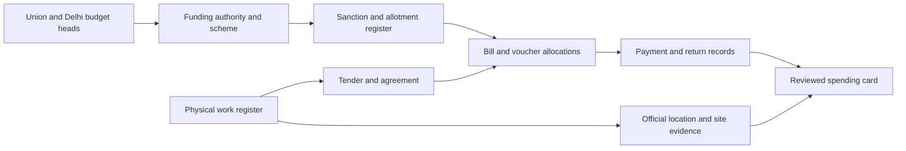

# Nationwide payment-source research — 7 October 2026

No verified public endpoint found that enumerates every Indian development payment with project allocations and geography. This is a research result, not proof that no such export exists. Existing departmental payment systems are not automatically public feeds. Documentation, live report access and acquired transactions are separate evidence levels.

## Prioritized routes

| Source                                          | Evidence found                                                                                                                                                                                               | Missing / next action                                                                                                                                                                                                |
| ----------------------------------------------- | ------------------------------------------------------------------------------------------------------------------------------------------------------------------------------------------------------------ | -------------------------------------------------------------------------------------------------------------------------------------------------------------------------------------------------------------------- |
| eGramSwaraj state exchange                      | Official NIC design document describes state-facing voucher exchange, payment detail amounts and work-reference sample fields. Existing public planning/approval/geotag services work for the pilot.         | Confirm supported current payment-read service, onboarding, official project allocation keys, settlement/reversal semantics and reuse. Do not call demo/private addresses or state-changing acknowledgement methods. |
| PMGSY OMMAS / state IFMIS / PFMS                | Public road/tender records already preserved across 32 source partitions; 210,946 unique source works. 2026 accounting manual search excerpt describes vendor claims through OMMAS/IFMIS and reconciliation. | Request masked claim-to-road/package allocations and final payment/reversal exports. Full 2026 manual download timed out; no live integration access established.                                                    |
| MGNREGA MIS                                     | Official reports advertise work/muster/wage-list/FTO search and expenditure. National scheme, strong potential official identifier chain.                                                                    | Obtain a real work→muster→wage list→FTO→bank-response sample. Public data portal fetch timed out here. Wage payment is not a contractor payment; protect worker identifiers.                                         |
| MPLADS eSAKSHI                                  | Official March 2026 release describes expanded public drill-downs and asset/supporting-document uploads. Portal explicitly scopes online works from 1 April 2023.                                            | Inspect one sanctioned work's payment documents, stable work ID, recipient and dates; request supported export. Aggregate expenditure alone is insufficient.                                                         |
| PFMS / APISetu                                  | PFMS API directory lists payment-status services, including scholarship status.                                                                                                                              | Obtain current API schema, subscription conditions and sanctioned use. A payment lookup does not prove a bulk project-payment catalogue. Never enumerate bank accounts or personal IDs.                              |
| Odisha PPMS                                     | Actual project-coded bill report, PDFs and visible recipient/workflow dialogs acquired.                                                                                                                      | Units, cheque-component scope, roles, settlement, site accuracy, report revisions and reuse unresolved. Continue bounded observed pages.                                                                             |
| West Bengal PHED                                | Live scheme financial drill-down has TSM/SM IDs, sanction dates and explicitly labelled lakh amounts. Index links 22 district reports.                                                                       | Preserve scheme rows as cumulative expenditure, not payments. PFMS expenditure page returned server error; agency-bill page timed out. Seek scheme/work-order→bill allocation exports and geography.                 |
| Uttar Pradesh JJM                               | Official dashboard shows scheme/village and estimated-cost/expenditure views.                                                                                                                                | Inspect supported scheme drill-down and paid-bill identifiers; no transaction export verified.                                                                                                                       |
| Andhra Pradesh CFMS                             | Official site describes works-module bill verification, measurements and recoveries.                                                                                                                         | Current public page inspected does not demonstrate a bulk bill→project export. Locate official citizen bill service and a legitimately obtained bill ID; no guessed ID scans.                                        |
| Haryana HEWP                                    | Official FAQ documents works/payment controls; employee/contractor access exists.                                                                                                                            | Ask for public work/payment reports or authorized masked export. Login functionality is not public payment coverage.                                                                                                 |
| Kerala PRICE / Tamil Nadu IFHRMS / Gujarat IFMS | Official pages/documentation establish estimating or treasury systems.                                                                                                                                       | Research leads only. Public project-linked paid-transaction exports not verified.                                                                                                                                    |

States without a tested acquisition route remain unassessed; nationwide schemes do not establish complete coverage of every state or every sector. Procurement award amounts, scheme transfers, cumulative expenditure and bank settlement must remain separate.

## Primary sources and access findings

- [NIC eGramSwaraj exchange design](https://cdnbbsr.s3waas.gov.in/s316026d60ff9b54410b3435b403afd226/uploads/2023/02/2023022755-1.pdf): original/checksum preserved privately; document is not access authorization.
- [PMGSY 2026 accounting manual](https://www.pmgsy.nic.in/sites/default/files/Accounting_Manual/ACCOUNTS%20Manual%202026_0.pdf): indexed primary excerpt, original fetch timed out.
- [MGNREGA](https://nrega.nic.in/) and [public data portal](https://nregarep1.nic.in/netnrega/dynamic2/dynamicreport_new4.aspx): portal fetch timed out.
- [MPLADS official release](https://www.pib.gov.in/PressReleasePage.aspx?PRID=2235932&lang=1&reg=1) and [public dashboard](https://mplads.mospi.gov.in/digigov/dashboard.html).
- [PFMS API directory](https://directory.apisetu.gov.in/api-collection/pfms): listing only; live schema/subscription not verified.
- [West Bengal report directory](https://maps.wbphed.gov.in/house_hold-2020/reports/reports-formats), [scheme financial report](https://maps.wbphed.gov.in/house_hold-2020/report/jjm-schemes-financial-status-distirct).
- [UP JJM](https://www.jjm.up.gov.in/jjm-dashboard), [AP CFMS](https://cfms.ap.gov.in/), [Haryana FAQ](https://works.haryana.gov.in/HEWP_Login/FAQs.aspx), [Kerala PRICE analytics](https://price.kerala.gov.in/price3_pmu/inner_dashboard.htm), [Tamil Nadu treasury](https://www.karuvoolam.tn.gov.in/), [Gujarat IFMS description](https://gil.gujarat.gov.in/pdf/IFMS_n.pdf).

## Completion gate for a newly discovered source

Provide one preserved real project record and one officially allocated dated transaction, exact identity keys, amount unit/basis, business recipient role, reversal/split handling, geography source, permission basis and documented collection path. Record missing fields and authorization needs. Only then build repeatable bounded collection; owner MFA publication remains separate.

## Review of the three supplied research reports — 7 October 2026

# Review of the three supplied payment-source reports

Reviewed 7 October 2026. These documents are research inputs, not instructions or authorization to send requests, bypass access controls, file RTIs, or publish unreviewed payments. Originals and checksums are retained privately.

## What changed our acquisition priorities

| Priority | Finding                                                           | What is established in this workspace                                                                                                                                                                                                                                    | Next evidence gate                                                                                                                                                                                                                             |
| -------- | ----------------------------------------------------------------- | ------------------------------------------------------------------------------------------------------------------------------------------------------------------------------------------------------------------------------------------------------------------------ | ---------------------------------------------------------------------------------------------------------------------------------------------------------------------------------------------------------------------------------------------- |
| 1        | Bengaluru BBMP work-bill payments                                 | Downloaded one FY 2025–26 CSV: 4,729 rows, nine fields, 3,964 distinct recognizable job codes. Official public viewer opens without login and shows job-linked bills, contractor labels, gross/deductions/net and RTGS records.                                          | Validate the historical CSV against official bills, resolve repeated bill IDs/payment attempts, confirm units, obtain exact geography and assess publication terms.                                                                            |
| 2        | MGNREGA Work Register Part B → wage list → FTO bank-response rows | The PDF gives a much more specific report chain and an example FTO/wage list than our earlier research. Its underlying live URLs/track files were not supplied. The other two reports did not establish a complete live chain.                                           | Reproduce one work-to-payment-line join through official navigation; preserve amounts/status/date meanings, rejection/reissue relationships and reviewed geography. Aggregate wage recipients privately rather than publish worker identities. |
| 3        | MPLADS eSAKSHI per-work vendor expenditure                        | Official dashboard retrieved. Its own explanation describes vendor payments against ongoing/completed works, online scope from 1 April 2023 and stakeholder-entered completion. Linked dashboard scripts provide an avenue for inspecting actual public report behavior. | Inspect a work's displayed expenditure rows; verify the work/payment join against the UI before using a bulk key. Do not accept reported 106,000-line counts or matching rates as our own acquired coverage.                                   |
| 4        | New PPMS expenditure/timeline report                              | PDF supplies `/report/ifms-transaction-expenditure-details`, apparently adding work-order, bill preparation, IFMS and completion dates. Our direct fetch timed out. Existing PPMS project/bill/cheque report collection remains usable.                                  | Follow the public report and compare exact project/bill keys with preserved pilot evidence. IFMS success and financial completion must remain distinct from recipient credit.                                                                  |
| 5        | West Bengal PHED scheme → work order → agency                     | Markdown report supplies a concrete Atharabeki scheme/work-order example and bill-register request scope. Our existing 9,337 scheme rows remain cumulative financial records.                                                                                            | Capture exact work-order editions and obtain bill allocations and dated payment responses; never turn cumulative payment into individual transactions.                                                                                         |
| 6        | PMGSY and eGramSwaraj custodian exports                           | Reports sharpen which records to request: payment transaction lines, road/activity allocations, deduction destinations and bank-response/reissue records. Old exchange documentation is not a current read API contract.                                                 | Keep PMGSY road requests separate from the Chandanbhati PR&DW pilot; append precise specifications when authorized, without duplicate outreach.                                                                                                |

## Bengaluru: an actual new acquisition, not just a recommendation

Source mirror: https://data.opencity.in/dataset/bbmp-work-orders-and-payments-2025-26

Observed resource: https://data.opencity.in/dataset/280a1196-074e-43ac-acd9-914918b429f5/resource/7a6907c2-6efd-43d6-99ac-1d10f67b3f85/download/bbmp-2025-26-198-wards-work-orders.csv

The preserved CSV has `slno`, `id`, `ward`, `wodetails`, `contractor`, `brnumber`, `amount`, `nett`, `deduction`. All 4,729 rows have contractor labels and embedded RTGS reference/date text. All satisfy amount minus deduction equals nett using exact decimals. There are 4,702 recognizable job-code rows representing 3,964 distinct job codes. Twenty-seven rows need another identifier interpretation. Fourteen row IDs repeat with differing RTGS records; no exact row duplicates exist after ignoring serial number. A repeated bill with the same amount but a different RTGS date could reflect a payment attempt or another event: neither sum both nor delete one without source history.

The mirror's retrieved catalogue lists “Other (Public Domain)” and a 14 May 2026 update. This corrects the PDF's claim that the license field is absent, but is not proof of every original record's scope or freshness. The original CSV does not independently define amount units or bank-credit semantics.

Official source: https://accounts.bbmp.gov.in/vssWB/

Browser verification opened the public Payments report and a job-linked bill. The date widget retained its default 1 April 2026–31 March 2027 range despite an attempted narrower input; the displayed 3,549 rows are therefore that default report's count, not a one-day sample or a count of reviewed transactions. No authentication or CAPTCHA bypass was used.

Observed work `045-22-000006`, “Foot path Maintenance in Ward No 45”: work order dated 19 November 2022; source contractor label LIHARIKA CONSTRUCTIO; Final bill; gross 1,864,036.00, deductions 285,665.00 and net/recorded Paid 1,578,371.00. RTGS-labelled date 1 April 2026; level explicitly **RTGS Generated**; credit/debit UTR fields blank. This proves a source-linked payment/instruction record, not independently verified recipient settlement. This is a different financial year and job from the CSV examples; no cross-edition reconciliation is claimed.

Uploads lists estimates, approvals, agreement, work order, measurement book, bill, photographs and completion-certificate controls. Clicking the completion-certificate control did not open a file; a listed control is not an acquired certificate. Exact works coordinates remain missing. Contractor columns can include personal phone numbers; these are excluded from safe review notes and must be removed before app publication.

Private evidence: `data/acquisition/report-review-2026-10-07/`, containing CSV/HTML originals, source metadata, checksums, arithmetic assessment and minimized browser observations. No payment publication or nationwide coverage count was changed.

## Corrections required before using the reports

1. **Chandanbhati is a PPMS/Panchayati Raj pilot, not an OMMAS/PMGSY road.** The PDF's sections 4 and 9.5 send its `OD/345/...` code to NRIDA/OMMAS; that code is not our PMGSY `IMS_PR_ROAD_CODE`. Its proposed Odisha Finance request also selects Rural Development while asking for this PR&DW project. Correct department, scheme and identifiers before sending or filing.
2. **PPMS public discovery is already working.** The PDF says cheque documents are discoverable only through search and no public index exists. We have preserved paginated official project/bill rows whose exact rows link payment PDFs. Those source-provided associations are stronger than name/amount proximity; they still do not prove allocation scope or settlement. Do not downgrade exact source links or adopt the PDF's suggested proximity join.
3. **MGNREGA “end-to-end” is overstated within the PDF.** Its executive verdict claims live testing end-to-end, while its dossier describes Work Register Part B/muster connections as documented or interaction-bound. The supplied FTO example is useful but no work-linked original accompanies it. Request the original report URLs/track files or reproduce the missing joins.
4. **MPLADS bulk joining remains disputed.** Counts and matching rates attributed to independent pipelines have no accompanying originals. A recommendation-detail ID may be scoped to an MP rather than globally unique. Confirm scope against source/UI before selecting a composite key; geography remains another gap. The PDF also contradicts itself about public work-level drill-down availability. The TXT's recommendation to abandon eSAKSHI is not justified by a historic cutoff alone.
5. **PFMS APISetu listing exists.** The official directory at https://directory.apisetu.gov.in/api-collection/pfms names payment-status services and reports a forbidden schema fetch. Thus the PDF's “no listing” claim is inaccurate. This does not establish a nationwide project-payment export, current working schema, or permission for bulk use.
6. **Current PMGSY flow supersedes a blanket absence claim.** Official indexed 2026 Accounts Manual section 3.2.4 describes OMMAS claims to IFMIS via API, state JSON claims and PFMS/RBI reconciliation. The PDF says this interface is documented nowhere using older material. Request current state/year-specific implementations; do not treat a historical manual as the present universal architecture.
7. **TXT endpoint/table names are unsupported.** `/v1/api/voucher/activity`, `Voucher_Activity_Mapping`, `OMMAS_to_PFMS_Reconciliation` and several exact field lists are asserted without a current primary specification. Treat them as requested relationships, not confirmed deployed endpoints/tables. Its simulated examples are not data; its purported MGNREGA example has inconsistent work-code digits and no reproduced payment chain.
8. **Ratings are not coverage.** TXT's High/Strong state ratings often infer public access from internal digitization. Guessed IDs, login bypass, simulated payment records and legal conclusions about APIs must not become implementation instructions. The report's AE/JE-as-transit-node assertion is also unproven for our pilot.
9. **Do not copy RTI legal conclusions unchecked.** The PDF offers detailed legal amendment claims and draft filing language. Those need current official-law and authority verification before filing. None of these attachments authorizes submissions, fees or new outreach.

## Useful reusable ideas

- Represent obligation, bill, allocated project share, payment attempt and reversal separately. A work may have many bills; a bill or payment may cover multiple works/components.
- Request the records the source actually holds, plus definitions and allocation crosswalks, rather than inventing a database table name or asking for a new unauthenticated replica.
- Show evidence levels separately: source-recorded expenditure; bill passed; instruction/RTGS generated; bank-reported processing/credit; independent settlement evidence. Do not require a bank statement to describe an official public bank-response record accurately, but do not label it independent verification.
- Keep reported completion, accessible stage photos, completion certificates and independent inspection as separate facts, rather than a single automatic completed state.
- Test one failed/reissued payment and one split allocation before scaling a source. The Bengaluru repeated-ID rows offer a concrete test case.

## Immediate order of work

1. Validate Bengaluru's historical CSV against official source bills; determine identities/attempts, units, contractor-field redaction and actual site documentation.
2. Reproduce one MGNREGA work → wage list → payment-line bank-response chain; record missing links precisely and prepare a separate materials/vendor request.
3. Inspect eSAKSHI's work expenditure view and validate a small cross-state work/payment sample. Do not run an unreviewed nationwide endpoint collector.
4. Assess the new PPMS timeline report and obtain pilot bill/settlement scope from the correct PR&DW/treasury custodian.
5. Continue WB work-order evidence and current eGramSwaraj/PMGSY export requests. Existing reply deadlines stay unchanged.

All these improve the plan. None establishes all-payment nationwide coverage, exact geography for every row, or permission to publish unreviewed records.

---

# Payment-source validation after the three-report review

7 October 2026. This records independently observed evidence, not claims copied from the supplied reports. No records published or owner decisions inferred.

## MPLADS: an official work-linked expenditure response obtained

The public dashboard at https://mplads.mospi.gov.in/digigov/dashboard.html currently raises a browser error in `loksaba.js` concerning an absent `contentDocument`. Clicking its expenditure tile did not replace the allocation table. Preserved public scripts identify a read-only report operation: `/rest/PreLoginDashboardData/getTilesReportData`. The actual handler sends `comboData.toString()`, not an array. State IDs come from its public `getStateData` report; Odisha is 25. A malformed initial array request returned only a zero total; it is preserved separately and not treated as evidence of zero spending.

The official Odisha request uses combo `25,0,0,2` and key `Expenditure on Completed and On-going Works as on Date`. Its 2,767,149-byte original is preserved privately with SHA-256. There are **3,826 expenditure rows and 2,195 distinct full WORK_ID values**. All returned state labels are Odisha. Source statuses: **3,719 Payment Success**, **107 Payment In-Progress**. All rows have parseable expenditure dates and non-negative finite amounts. The public script labels FUND_DISBURSED_AMT in rupees. These are source-reported vendor expenditure records; success is not promoted to independently verified bank settlement.

Fields include ACTIVITY_NAME, WORK_ID, WORK_RECOMMENDATION_DTL_ID, MP_NAME, HOUSE_OF_PARLIAMENT, TENURE, IDA_NAME, IA_NAME, VENDOR_ID, VENDOR_NAME, EXPENDITURE_DATE, FUND_DISBURSED_AMT and WORK_STATUS. A full work ID looks like `WS/MP373/2025-2026/249707`. Retain the full WORK_ID, house and source scope when connecting documents; do not assume the recommendation ID alone is globally unique. This sample has no recommendation IDs shared across different MP labels, but that does not prove nationwide uniqueness. The default combo does not explicitly filter a tenure; do not describe this as a validated single-tenure universe merely because the browser heading says 18th Lok Sabha.

**Still missing:** stable individual payment/bill references, reversals/reissues, allocation and reconciliation definitions, work geometry, supporting agreements/sanctions/completion documents and publication review. No amounts are summed. Equal work/date/vendor/amount rows are retained rather than deduplicated on assumed transaction identity. Seven rows have invalid UTF-8 bytes: the parser preserves those bytes as escaped values and flags their text for review. No replacement names are invented. A country-wide response exceeded a 50 MiB collection bound and was not accepted; use bounded state/tenure or MP partitions identified by official lists.

Private input manifest: `data/acquisition/mplads/public-script-review/odisha-expenditure-response.json`. Private normalized review: `odisha-normalized-review.json`. Public summary: `data/mplads-payment-source-assessment.json`. Reproduce assessment with `python3 workers/mplads_payment_assessment.py`.

## Bengaluru: full net bill value is not necessarily paid amount

Normalized 4,729 mirrored FY 2025–26 rows into **4,715 provisional bills**, **4,729 event references**, and **3,964 recognizable job codes**. Twenty-seven rows need job identifier interpretation. Fourteen source bill IDs occur with different RTGS events; exact duplicate rows are zero. Gross minus deductions equals net in every row. This checks arithmetic, not units, successful payment, allocation or location.

Compared two historical mirror bills with the official viewer https://accounts.bbmp.gov.in/vssWB/ through visible Bill Status searches:

| Official job  | Net bill value | Displayed Paid | Selected RTGS date | Another listed RTGS date |
| ------------- | -------------: | -------------: | ------------------ | ------------------------ |
| 198-21-000007 |   4,791,650.00 |   3,542,778.00 | 16 Oct 2023        | 1 Apr 2025               |
| 012-20-000078 |     700,640.00 |     518,825.00 | 9 Apr 2025         | 5 Jul 2025               |

Mirror gross, deduction and net values match the bills; they do not identify the individual transaction amounts. Both selected events show RTGS Generated and populated UTR fields. Presence of a UTR is recorded privately as a boolean; no banking identifiers or contractor phones are propagated. The earlier current-year sample had blank UTRs, so that observation must not be generalized to these historical samples. The UI shows different RTGS events; whether they represent instalments, reissues or other history needs evidence. Never count the full net value for each event.

The new assessment worker keeps bills and payment references separate, leaves transactionAmount unknown, retains differing editions and strips contractor strings entirely from normalized review output. It creates no monetary total or approvals. Exact geography, recipient business capacity, amount definitions and publication review remain pending.

Private review: `data/acquisition/report-review-2026-10-07/bbmp-normalized-review.json`. Minimized historical UI observation and checksum are indexed by `bbmp-historical-primary-observations.json`. Reproduce with `python3 workers/bbmp_payment_assessment.py`.

## MGNREGA: one actual work-to-wage-list link observed

Used official public navigation: Madhya Pradesh → Bhopal → Berasia → Amarpur → Work Register. Plantation work **1728001019/DP/22012034619924**, near a segregation shed in Barkheda Kalan, shows technical and administrative sanction dates 26 June 2024; start 20 July 2024; estimated completion 20 April 2025; actual completion blank. Sanction amounts 1.036452 unskilled and 0.9629077 material remain raw because the viewed register does not establish their units.

Its Work Register detail lists wage list **1728001019WL007148** against three musters: 16618 (48 person-days, reported paid 11,664); 16619 (60, 14,580); 16620 (18, 4,374). Total: **126 person-days, 30,618 reported paid, zero reported due**. The separate work-wise consolidated payment report explicitly labels Total Cash Payment in rupees and shows the same total. Its date column is **Data Entry Date**, not bank settlement date. Do not use that date as payment date.

No FTO/bank response chain has yet been reproduced. Worker identities and job-card/banking identifiers are excluded from the minimized observation. An independent fetch of the observed Work Register URL returned HTML without this work; it is preserved but explicitly rejected as an original of the displayed register. Navigation/session report scope needs preservation before relying on this chain. Exact geometry, completion evidence and publication review remain missing.

Private minimized observation: `data/acquisition/mgnrega/amarpur-pilot/assessment.json`. Continue through official wage-list/FTO navigation rather than guessing encrypted report payloads or assuming the same report across sessions.

## Nationwide MPLADS collection completed for the default Lok Sabha scope

Collected and assessed all **36 official state and union-territory partitions**, with zero failed partitions. The preserved responses contain **89,497 source expenditure rows linked to 59,785 distinct full work IDs**. Source status counts: **86,335 Payment Success**, **3,162 Payment In-Progress**. There are **194 rows with encoding faults**, retained for review. Every state original checksum was verified. Re-running the collector after completing the list made no new network requests and rebuilt the same summary from preserved originals.

This is nationwide collection for one development scheme's default Lok Sabha public filter. It is not complete Indian government spending, all MPLADS tenures/houses, a set of independently verified transactions or verified project geography. No payment amounts were summed, no inferred transaction IDs created and no map dots approved. Full WORK_ID remains the key; this collected scope has zero recommendation IDs mapping to different full work IDs, but other scopes still need validation.

Collection: `python3 workers/mplads_state_collection.py --max-states 6` processes at most six previously unattempted official state IDs per invocation. Each response is limited to 20 MiB and 35 seconds. Checkpoints, request bodies, source originals, content types and checksums are private in `data/acquisition/mplads/state-expenditure/`. Public aggregate summary: `data/mplads-state-collection-assessment.json`. Failed partitions remain explicit and are not silently converted to zero spending. The separate initial Odisha export is an earlier source observation; do not add it to the state collector totals.

Next: validate supporting work/payment documents and actual locations for a small review sample, investigate encoding faults and reversal/payment references, and collect Rajya Sabha and explicit tenure scopes through their observed official UI definitions. Keep previous editions rather than overwriting them.

## Next bounded work

1. MPLADS: retrieve supporting work records for a small Odisha sample using full work identity; confirm payment references/allocations, encoding and geography. The default Lok Sabha state collection is now complete; next expand only validated house/tenure filters with checkpoints.
2. Bengaluru: inspect event history for the two compared bills, obtain explicit paid amounts and actual project location; review the 27 ambiguous identifiers.
3. MGNREGA: obtain the wage list/FTO bank response and preserve the displayed report scope; distinguish wages, materials and vendor payments.
4. Continue Odisha PPMS, existing agency requests and targeted RTI drafts in parallel with these acquisitions. New correspondence and fee submissions require their own authorization.

Verification: nine new parser tests cover repeated events, no invented transaction identity, amount/date distinctions, conflicting editions, privacy minimization and invalid encoding. Public tracker exposes aggregate progress only; originals, recipients and unreviewed evidence stay private. No paid map dots or approvals added.

---

# MPLADS supporting-payment pilot review — 7 October 2026

Five Odisha projects have scoped source matches across sanction, completion and expenditure reports: recommendation ID + MP + state + constituency + known Lok Sabha scope. Internal numeric WORK_ID in completion/attachment reports differs from the full WS/MP… payment identifier. Never compare them as a single identifier namespace. These joins are documented review candidates, not owner publication approvals.

Downloaded **seven official attachments** for the five projects: **two final bills**, **four completion certificates** and **one school photograph**. All five PDFs are scanned, with no usable text layer; seven pages were visually inspected. The school photograph has no GPS EXIF metadata. It cannot establish exact coordinates by itself.

| Pilot                                                  | Sanction / portal expenditure                                        | Supporting-document finding                                                                                                                                                                                                                                                                       |
| ------------------------------------------------------ | -------------------------------------------------------------------- | ------------------------------------------------------------------------------------------------------------------------------------------------------------------------------------------------------------------------------------------------------------------------------------------------- |
| Govt U.P. School Kusumura computer education, 140197   | 480000 rupees; one source Payment Success row dated 8 May 2025       | Signed certificate supports purpose, 480000 work value and physical completion 18 March 2025. Portal completion is 8 May 2025. Invoice/contract and individual payment reference absent.                                                                                                          |
| Damjhar–Badhiamunda bridge, 148060                     | 200000 rupees; one source Payment Success row dated 19 June 2025     | Signed certificate matches bridge, block and estimate; handwritten physical completion day remains ambiguous. No exact date invented.                                                                                                                                                             |
| Muliguda culvert, 153906                               | 200000 rupees; one source Payment Success row dated 24 March 2026    | Signed first/final bill: gross capped 200000, deductions 16452, net payable 183548; measurement-book reference and case record visible. Receipt/bank response absent. Portal vendor is a junior engineer; final contractor recipient is unproven.                                                 |
| Bainchua library hall, 157039                          | 500000 rupees; four source Payment Success rows dated 13 May 2026    | Signed certificate states 500000 and physical completion 21 April 2026; portal completion is 15 May 2026. Administrative block labels include handwritten corrections. Recipient rows include principal amount and institutional deduction-like labels; allocation/roles need source definitions. |
| Saraswati Sishu Mandir classroom, Bhuinpur/Aul, 160336 | 800000 rupees; one source Payment Success row dated 8 September 2025 | Signed bill: work value 814468.04 capped at 800000; deductions 38900; net payable 761100. Signed certificate physical completion 5 August 2025; portal completion 8 September 2025. Photograph retrieved without GPS metadata.                                                                    |

The two gross-minus-deduction calculations agree exactly. Matching gross amounts do not prove net cash received. The eight source expenditure rows have Payment Success labels, but no stable transaction ID, bank response or independently established final-recipient capacity. For the library, the four row sum is an accounting reconciliation only, not a verified transaction total. Neither recipient names nor nearby assets establish allocation or location.

Certificate dates and portal dates are preserved separately. These differences may reflect physical completion versus later administrative marking; do not assert error or corruption without the source definitions. Sanction amount, gross bill value, net payable, source-reported disbursement and independent settlement remain separate facts. Official source-reported payments can be labelled accurately in future owner-reviewed partial cards; lack of an independent bank statement does not erase the official reported fact. No contract, exact map location or owner approval is inferred.

The public sanction report advertised attachments for 894 rows. Direct file downloads for the five selected sanction ATTACH_IDs returned empty lists. Separately, its completed-work attachment-list operation returned actual filenames and download IDs: all seven corresponding downloads succeeded. Do not treat an attachment flag or filename as proof of a readable sanction order or completion certificate.

Private provenance: `data/acquisition/mplads/supporting-records/`. Each report/download manifest preserves URL, exact public request body, timestamp, response checksum, binary checksum and source linkage. `document-observations.json` contains minimized visual transcriptions; `pilot-review.json` contains scoped source rows and unresolved checks. No bank identifiers or signatures are transcribed into public data. Public aggregate summary is `data/mplads-supporting-review-assessment.json`. Reproduce with `python3 workers/mplads_supporting_review.py`.

Prepared the specific missing-record request below; it has not been sent. Next: identify the named district/implementing-unit custodian and actual work locations; obtain contracts, payment references and deduction allocations. Keep every original and source edition. Publication remains through owner MFA and explicit decisions. Three new reconciliation tests reject cross-MP/house/constituency joins and prevent gross bill matches from becoming net settlement approvals.

# MPLADS pilot: request existing payment and allocation records

Prepared, not sent or submitted. Verify the relevant district/implementing-agency custodian and current official contact before outreach. No RTI fee, personal applicant data or new message is authorized here.

For the following five named Odisha projects, through 7 October 2026:

- WS/MP370/2024-2025/140197 / recommendation 140197: Computer Education project at Govt. U.P. School, Kusumura, GP-Kusumura, Block Balisankara — implementing agency BLOCK BALISANKARA; sanction 480000.00 rupees on 05-Dec-2024.
- WS/MP18144/2024-2025/148060 / recommendation 148060: Construction of bridge with guard wall between RD road damjhar to badhiamunda village — implementing agency BLOCK OFFICE BODEN; sanction 200000.00 rupees on 22-Jan-2025.
- WS/MP453/2025-2026/153906 / recommendation 153906: Construction of Culvert at Muliaguda of Hanumantpur GP under Chandrapur Block — implementing agency BLOCK CHANDRAPUR; sanction 200000.00 rupees on 13-Jan-2026.
- WS/MP300/2025-2026/157039 / recommendation 157039: Block-Balianta, Construction of Library Hall of Village- Bhainchua, GP-Bainchua — implementing agency Block Development Officer, Balianta_IA; sanction 500000.00 rupees on 02-Apr-2025.
- WS/MP18145/2025-2026/160336 / recommendation 160336: Construction of classroom of Saraswati Sishu Mandir — implementing agency BLOCK AUL; sanction 800000.00 rupees on 02-May-2025.

Please supply existing project-linked bill/payment-register or voucher entries showing stable payment references, expenditure and settlement/status dates, gross amount, deductions, net amount, recipient capacity, reversals/reissues and allocation across recipients. Please identify whether FUND_DISBURSED_AMT in the public dashboard represents gross authorized project cost, gross transfer, net credit or another amount. Provide existing accounting definitions and the recorded role of a junior engineer or other department official listed as vendor.

Specific discrepancies to explain through existing records:

- School classroom work 160336: portal records 800000 rupees on 8 September 2025, while the final bill shows a capped gross 800000, deductions 38900 and net payable 761100. Supply the recorded allocation/disposal of deductions, the payment reference and recipient-role record. Certificate physical completion is 5 August 2025; portal completion is 8 September 2025. Clarify the recorded meanings of these dates.
- Culvert 153906: portal records 200000 rupees on 24 March 2026 to JUNIOR ENGINEER CHANDRAPUR ONE; bill shows gross 200000, deductions 16452 and net payable 183548. Supply records for the engineer's accounting role, deductions allocation and onward payment, if held.
- Library 157039: four expenditure rows total 500000 (494172 + 552 + 276 + 5000), including institutional recipient labels. Supply voucher IDs and allocations; identify which are deductions, final supplier payments or internal transfers. Certificate completion 21 April 2026 differs from portal 15 May 2026; retain existing records explaining administrative marking versus physical completion.
- Computer-education project 140197: certificate completion 18 March 2025 differs from portal completed/expenditure date 8 May 2025. Supply invoice, contract/work order and recorded payment reference/status.
- Bridge 148060: provide a readable certificate or recorded physical completion date, together with agreement and payment-register entries. Handwritten certificate day is ambiguous in the supplied public scan.

Also provide existing sanction orders/amendments and agreement/work-order records, actual project location records/geotags, document field definitions, reporting cutoff, attribution and permissible republication terms. The five ATTACH_ID values directly in the public sanction report returned empty download responses; supply the relevant existing sanction orders or correct public attachment references.

Do not supply bank account numbers, Aadhaar/PAN, private phone numbers or unnecessary personal identifiers. Transaction references may be minimized where appropriate while retaining an auditable source link. No request to create a new analysis or certify facts outside existing records.

<!-- BEGIN 2026-10-09 BLOCKER SOLUTIONS -->

# Hisaab: solutions to the nationwide evidence and product blockers

Research checkpoint: 9 October 2026. This is a researched implementation and acquisition strategy, not a declaration that the missing records have been obtained. Publicly published verified spending projects remain zero. Existing evidence, conflicts and owner approval gates are unchanged.

## What changes in our approach

The original product needs a source-backed evidence chain, not a large set of unrelated locations. Its source documents already allow incomplete chains, missing fields and visible uncertainty. We should review and publish each supported fact, after its identity, rights and evidence checks, rather than wait for every field to become complete. A properly reviewed official payment report can be labelled “officially reported payment”; it must not become “recipient settlement confirmed” without suitable transaction evidence. A financial record without actual geography belongs in the spending ledger and coverage counts, not at an invented map point.

No public universal feed of every Indian development payment was verified in this research. Government systems do contain useful connections, but many are available only to their record custodians. The viable strategy combines national scheme connectors, state works/treasury connectors and documented agency exports. National coverage is measured by scheme, jurisdiction, financial year and evidence stage; one national scheme is not all government spending.

## 1. Connect actual projects, locations and payments

**Solution:** request the existing crosswalk records held at the point where works systems hand bills to accounting systems. Build a namespaced graph: physical project/activity → sanction/package/agreement → bill and component → allocated payment → response/reversal. Maintain separate many-to-many allocation records. A treasury or PFMS “project” may identify a programme rather than an individual road; confirm its granularity before linking it to a dot.

The official [eGramSwaraj changes notice effective April 2021](https://panchayat.tripura.gov.in/sites/default/files/2023-10/List%20of%20Changes%20effective%20in%20eGramSwaraj%20wef%201_April_2021.pdf) documents work-code selection for XV Finance Commission payment vouchers and geotag eligibility. This is a specific work-to-voucher route for that documented scope, not proof that every current voucher contains a complete location or payment chain. Request activity IDs, voucher IDs and the existing asset/geotag link for our two Chandanbhati candidates; verify the returned rows against the originals.

The [CGA project-creation and agency-mapping instructions](https://cga.nic.in/writereaddata/file/OMNo354-357dtdt29012025.pdf) document project creation and selection in TSA Hybrid claims for enabled ministries/schemes. Ask the programme division for its project-agency-claim mapping and the implementing agency for the physical work crosswalk. This is not an anonymous public API or a universal asset identifier.

**Newer, higher-priority route:** the [1 September 2026 agency programme/project SOP](https://cga.nic.in/writereaddata/file/ITD94dt01092026.pdf) documents programme/project codes, claim transaction/voucher details, vendors, components and deductions. Request the existing agency-project-to-claim/component mapping for applicable pilots. Crucially, programme/project fields are non-mandatory in limit allocation; missing codes remain missing. The [30 September 2026 limit-allocation SOP](https://cga.nic.in/writereaddata/file/ITD108dt30092026.pdf) retains that optionality. Assignment limits are spending authority, not money already paid. Confirm physical-project granularity and actual module adoption; these manuals do not establish public access or universal historical coverage.

**First execution:** use the 155 Balangir dossiers and five MPLADS pilots, not all 812,976 historical locations. Request the PPMS Case Record Report / Project All Document bundle identified in the preserved official manual, plus the accounting crosswalk. Keep the 7,161 OMMAS geography proposals as candidates until project identities, geometry editions and financial links pass review.

**Acceptance:** one real original links an exact physical work to an exact bill/payment allocation and actual source location. Package shares reconcile without copying the full package amount to each project. Independent site confirmation remains a separate evidence stage.

## 2. Obtain genuine payment details and stop double counting

**Solution:** acquire records from both the works custodian and the payment custodian. Request component-level gross, deductions, net, recipient capacity, payment reference, date roles and failed/reissued/reversed lineage. Retain reported expenditure separately from individual payment events.

The [CGA SNA-SPARSH FAQ and state practices](https://cga.nic.in/writereaddata/file/OMNo115dt25092025.pdf), PDF pages 23–24, distinguish transaction responses from file-level fund movement and place individual deductions in State IFMIS rather than PFMS. Page 40 describes Odisha post-payment claim deconsolidation. Pages 57–60 describe Chhattisgarh FTO consumption and response integration. These give precise custodian/export targets; they do not establish that our pilot bills use these workflows or that Hisaab can access them.

For applicable TSA schemes, request the existing [CGA report exports](https://cga.nic.in/writereaddata/file/OMNo30SOPTSAdt04062025.pdf): TSA01 transaction tracking, TSA02 expenditure, TSA07 transfers and TSA08 rejected/cancelled/reversal details; for TSA Hybrid, HTSA02 claim tracking, HTSA05 expenditure, HTSA06 transfers and HTSA09 agency monthly expenditure. Preserve the report's Figures In selection, dates, scope, status and identifiers. A transfer report is not a second contractor payment. Expenditure summaries can include stages that do not establish final credit; validate their definitions.

The [TSA Hybrid deduction instructions](https://cga.nic.in/writereaddata/file/OMNo284-324dt27112024.pdf) and [failed-claim reinitiation/cancellation procedure](https://cga.nic.in/writereaddata/file/SOPReinitiationPermanent26dt04062025.pdf) identify separate deductions and failed/reissued paths. They are possible accounting explanations to investigate, not proof resolving our observed gross/net differences.

**First execution:** resolve the five MPLADS recipient-role/deduction questions and the five PPMS missing-cheque-date cases using named registers and bank-response extracts, with banking identifiers omitted. For MGNREGA, retain work → muster → wage-list → FTO → transaction response links. Neither Data Entry Date nor the central-share transfer date becomes a worker's credit date.

**Acceptance:** each payment has a stable source identity, documented allocated share, amount basis and date role. Returns reduce the relevant event; a replacement links to the failed original. Unknown recipient capacity remains unknown. Totals count terminal allocated flows once, keep transfers out, and disclose incomplete allocation coverage. Statutory deductions, advances and contractor payments are not mixed into one unexplained number.

## 3. Expand nationwide without pretending one source covers everything

**Solution:** maintain a coverage matrix with jurisdiction × scheme/department × year × stage. Distinguish source discovered, access tested, sample acquired, linkage validated, refresh validated and publication reviewed. Add independent sources through the same schema. Explicitly retain unlocated financial records and uncovered sectors.

| Route                         | What is supported now                                                                         | Exact next evidence                                                                                                 | Limitation                                                                                                 |
| ----------------------------- | --------------------------------------------------------------------------------------------- | ------------------------------------------------------------------------------------------------------------------- | ---------------------------------------------------------------------------------------------------------- |
| MPLADS                        | Existing default reports across both houses and observed state partitions                     | Pilot voucher references, deductions, actual sites; later tenure filters                                            | One scheme, stated dashboard period and filters                                                            |
| Odisha PPMS                   | Existing statewide bill inventory and Balangir bill/photo dossiers                            | Work-document bundle and project/component/payment crosswalk                                                        | Treasury processing is not all state development expenditure                                               |
| eGramSwaraj                   | Existing Chandanbhati planning/approval/geotag samples and cashbook                           | Activity-voucher-geotag crosswalk and current permitted voucher export                                              | Mandatory work-code notice has a particular grant scope                                                    |
| PMGSY / OMMAS / eMARG         | Existing financial/geography candidates; official maintenance workflow                        | Road/package bill allocations, maintenance agreements, inspection/bill/payment records                              | Construction and maintenance are separate scopes; historical off-system records may remain                 |
| MGNREGA                       | Existing observed work/muster/wage-list pilot                                                 | FTO and transaction responses, work-code geotags                                                                    | Wage, material and other components need separate treatment                                                |
| Rajasthan WAM / IFMS          | Official works/work-order/vendor-bill-to-treasury workflow                                    | Authorized division sample with bill/voucher/payment mapping                                                        | Authenticated departmental workflow; no public bulk export verified                                        |
| Chhattisgarh e-Kosh           | Official integration documented in CGA state-practice manual                                  | Custodian-held FTO/claim/bill mapping and response extract                                                          | Module and scheme applicability must be confirmed                                                          |
| Kerala PRICE / BiMS           | Official directory identifies estimates and bill-management systems                           | Existing estimate/work-order/bill crosswalk from implementing unit                                                  | Directory presence does not prove a usable public payment export                                           |
| Haryana HEWP                  | Official works/e-measurement guidance                                                         | Agreement/measurement/bill/payment sample from department                                                           | Role-based workflow, not verified nationwide feed                                                          |
| Bengaluru works bills         | Two official historical comparisons and existing mirror assessment                            | Event-level amounts, instalments/reissues and exact work locations                                                  | Net bill cannot be substituted for the displayed Paid amount                                               |
| Andhra Pradesh CFMS           | Official portal lists works workflow                                                          | Custodian sample with work/MB/bill/payment keys                                                                     | Public bulk transaction access not established                                                             |
| West Bengal water works       | Existing cumulative report inventory                                                          | Individual bill/payment allocations and site evidence                                                               | Cumulative expenditure is not transaction-level payment coverage                                           |
| JJM 2.0 water schemes         | Current 2026 guidelines identify scheme finance and asset registries                          | Scheme/asset IDs → implementing-agency claim → IFMIS bill → transaction response                                    | Mandated integration is not a publicly accessible complete export                                          |
| Railway procurement and works | Official post-contract supplier bill workflow and earlier documented works-system integration | Work/project/order → receipt/inspection → bill → IPAS payment/return mapping from responsible railway unit          | Supplier procurement is not every station construction or works contract                                   |
| NHM infrastructure            | Official finance and PFMS guidance identifies financial custodians                            | Named facility/project approval → agreement/invoice → voucher/payment mapping from health society/implementing unit | FMR aggregates, staffing expenditure and health-service payments are not all hospital development projects |

Primary entry points: [Rajasthan WAM](https://wam.rajasthan.gov.in/), [Kerala LSGD systems](https://lsgd.kerala.gov.in/en/digital-governance/other-systems/), [Haryana HEWP FAQ](https://works.haryana.gov.in/HEWP_Login/FAQs.aspx), [AP CFMS](https://cfms.ap.gov.in/), [PMGSY eMARG notices](https://pmgsy.nic.in/e-marg-letters). Portal inspection and documentation establish leads, not export permission. No new credentials, hidden endpoints or guessed payment identifiers were used.

**Water sector bridge:** the [JJM 2.0 operational guidelines](https://jaljeevanmission.gov.in/sites/default/files/guideline/Operational-Guidelines-JJM-2.pdf), visually inspected PDF pages 78, 81 and 137, describe Sujalam Bharat scheme/asset georeferencing and claims through JJM-MIS and State IFMIS, with scheme-level SNA-SPARSH integration. Request the existing scheme-ID/asset-ID/claim crosswalk, geometry, implementing-agency bills and transaction responses together. The [6 August 2026 ministry announcement](https://www.pib.gov.in/PressReleasePage.aspx?PRID=2295509&lang=1&reg=1) reports SNA-SPARSH releases across thirteen states. Those central releases are not thirteen states' complete contractor-payment records. This is a strong new sample route, not an acquired public API.

**Rail and health targets:** the official [railway supplier post-contract manual](https://rwp.indianrailways.gov.in/works/uploads/File/User_manual_for_vendors_on_Post_Contract_Activities%281%29.pdf) connects digital supplier bills and receipt/inspection documents with IPAS processing. Obtain minimized mappings from the bill-paying unit; do not request a supplier's login or infer a bill was paid merely because it was submitted. The [Railways 2021–22 yearbook](https://indianrailways.gov.in/railwayboard/uploads/directorate/stat_econ/2023/PDF%20Year%20Book%202021-22-English.pdf) describes IRPSM integration with IREPS and IPAS/AIMS; verify current adoption for the actual works pilot. [NHM Finance](https://nhm.gov.in/guidelines/index1.php?lang=1&level=1&lid=166&sublinkid=1039) identifies finance responsibilities at state/district levels, and its [PFMS guidance directory](https://www.nhm.gov.in/index4.php?lang=1&level=0&lid=438&linkid=351) supplies workflow documentation. Request an existing facility-specific construction bill/voucher crosswalk from that custodian; a financial-management aggregate is insufficient.

Use [CAG state accounts](https://cag.gov.in/en/state-accounts-report?defuat_state_id=76) and [official output-outcome frameworks](https://dmeo.gov.in/output-outcome-framework) as scope and reconciliation context. Compare totals only for matching period, fund flow and accounting basis. Do not add Union transfers to state end-use payments. A gap is a collection/reconciliation gap, not evidence of corruption. Other states, railways, hospitals, housing, urban utilities, public enterprises and local/off-budget spending remain separate acquisition scopes; no all-sector connector was verified for them.

**Acceptance:** a real sample and repeat-import test precede wider partitions. Published coverage states its denominator and cutoff. “Nationwide” requires a defined scope; “all nationwide payments” cannot be asserted while schemes, local bodies, historical periods or cash/off-system transactions remain unaccounted for.

## 4. Resolve amount conflicts, units and conflicting dates

**Solution:** make source meaning part of the record: currency, declared scale, amount basis, reporting period, stage/date role, revision and evidence locator. Preserve editions and ask for the existing instruction/amendment explaining differences. A numerical match produces a reconciliation observation, not approval.

The CGA reports manual explicitly offers Actuals, Thousands, Lakhs and Crores. A copied number without the selected scale is insufficient. The PPMS illustrative running-account bill has rupee labels but does not define its separate public report field. Our eight readable PPMS discrepancies remain unresolved even after matching their component tables; do not round them away. Keep the eight OMMAS sanction conflicts and nine-parent/ten-export discrepancy visible until a dated scope/amendment resolves them.

**First execution:** send no new message automatically. Add a field-definition schedule to the existing custodian requests: exact pilot bill IDs, report amount, component sum, cheque amount, observed units, filter and source edition. Ask for existing accounting/rounding instructions, not a newly invented explanation.

**Acceptance:** conversions preserve source decimals exactly; source-declared tolerances are recorded. Physical completion, portal marking, bill entry, cheque issue, treasury processing and recipient credit are separate dates. Conflicts can block the affected fact or total while unrelated reviewed facts remain usable.

## 5. Obtain real geography and meaningful completion evidence

**Solution:** keep geography and completion as independent evidence chains. A point, road line or project footprint must have source identity, capture date, precision and geometry edition. Do not replace missing project geography with a district centre. Display source-reported sites and independently checked sites with distinct labels after review.

The official [GeoMGNREGA manual](https://bhuvan-app2.nrsc.gov.in/mgnregatpv/mapview/apptools/nrega_tpv/nrega_manual_v1.pdf) documents work-coded geotag workflows and authorized block/district/state roles. Request the approved work-code/location records from those custodians; a statistics/user CSV in the manual is not a verified public bulk asset export. Check current schema before ingesting an older manual's workflow.

[PMGSY's open-GIS release](https://www.pmgsy.nic.in/sites/default/files/Press_Releases/PIB1800373_2.pdf) supports a licensed road-geography route. The GeoSadak endpoint was unavailable during this research; preserve the existing pinned release and verify its licence, release edition and road IDs before use. This geography licence does not authorize unrelated finance or third-party imagery. [UDISE school GIS](https://gis.udiseplus.gov.in/) is a school-site lead; link a school payment only when the financial document identifies that institution or a custodian supplies its official crosswalk.

For completion, obtain the existing certificate, issuer, named work and recorded date. Before/during photographs do not certify completion; source photo approval does not establish independent site verification. User media can supplement evidence with consent and visible status, but cannot certify government payment.

**Acceptance:** the selected dot opens the matching physical project and geometry source. Photo stage, certificate completion, portal status and citizen observations remain separate. No 3D building extrusion implies that the spending financed that building unless the identity chain supports it.

## 6. Reduce dependence on unanswered departments

**Solution:** ask for narrow existing tables and reports from the accountable custodian, not just an API from a helpdesk. Offer a redacted five-project sample before a national export. Ask support to identify the programme division, DDO/PAO, treasury, implementing unit and technical operator separately. Request a data dictionary, cutoff, update schedule, attribution, correction contact and publication terms alongside the sample.

Continue the four agreed routes in parallel: permitted public reports; authorized department exports; targeted RTI for existing records; local implementing-unit partnership. A useful alternative to unrestricted API access is a custodian-produced periodic CSV plus a document manifest. Another is supervised inspection of named existing records followed by minimized copies. Neither requires sharing departmental login credentials.

[API Setu policy](https://docs.apisetu.gov.in/document-central/api-policy/Policy%20Statement.html) is an access framework, not proof of an open PFMS payments endpoint. [GODL](https://ap.data.gov.in/godl) applies to covered released data, not every government webpage or personal record. Separate access, authenticity and republication permission. Obtain a permitted public derivative without banking details or signatures; keep originals private.

For RTI, identify the proper central or state authority. The [central portal guidance](https://www.rtionline.gov.in/guidelines.php?appeal=&pageid=c4ca4238a0b923820dcc509a6f75849b) does not provide a route for every state/local authority. Ask for the named existing sanction, bill allocation, voucher and response records, with permissible redaction and recorded inspection routes; do not promise disclosure or request a new analysis. Applicant eligibility/details, submission and applicable fees remain owner tasks. Follow-ups retain the agreed dates and require specific outbound authorization. No new email, application or paid filing was performed by this research.

**Acceptance:** an actual sample with declared custody, identities, source definitions and reuse basis. A forwarding email, system manual or informal assurance does not close this blocker. If records do not exist or cannot be released, retain that documented gap and use a supported partial card.

## 7. Finish the whole application and production release

**Solution:** deliver the original user workflows while clearly separating software readiness from completeness of government records. The map is one view of an evidence ledger. Historical assets stay optional; scoped spending records stay primary. Add stage filters so a Paid selection does not silently show sanctions as paid projects.

| Product area          | Concrete completion route                                                                                                                       | Acceptance evidence                                                                                           |
| --------------------- | ----------------------------------------------------------------------------------------------------------------------------------------------- | ------------------------------------------------------------------------------------------------------------- |
| Map and receipts      | Stable project IDs across tiles and receipt API; source links; partial facts and missing stages; geometry precision                             | Click every pilot feature and verify the matching project/source; empty/failed queries explain coverage       |
| Review and totals     | Explicit fact/entry decisions; conflicts and approvals enforced by server and database; event/allocation lineage                                | Unsupported approval rejected; missing stages remain missing; transfer/reversal/split tests pass              |
| Citizen reporting     | Consent, private originals, redacted derivatives, offline retry, factual review and duplicate suggestions                                       | Sensitive evidence excluded from public output; retries do not duplicate a report                             |
| File / Track / Verify | Prepare a dossier for the proper official portal; user files; store authentic registration/status receipts; distinguish closure from resolution | No claimed filing without official receipt; no fabricated integration or automatic complaint                  |
| Accountability        | Correction/right-of-reply records, evidence-backed moderation and audit history                                                                 | Contested facts stay visible with provenance and decision history; AI does not accuse unsupported actors      |
| Access and inclusion  | Owner MFA, private evidence boundaries; keyboard/list alternative; low-data mode; reviewed language content                                     | Unauthenticated private endpoints remain denied; mobile/offline/error paths and accessible navigation checked |
| Hosted data           | Move large local geography archive to a licensed immutable tile/object service or dedicated tile server; host receipt/search data separately    | Public selection works after local computer is off; private originals absent from deployment bundle           |
| Deployment            | Git secret/data exclusion, reproducible build, staging, managed migrations/backups, domain/security headers, monitoring and rollback            | Restore rehearsal, owner MFA, source reachability, privacy and live map tests pass before production launch   |

The [CPGRAMS FAQ](https://pgportal.gov.in/Home/Faq) and [official portal](https://pgportal.gov.in/) support an official submission/tracking route. No universal Hisaab filing API was verified. Start with accurate file assistance and owner/user-provided registration evidence; route RTI separately. Local reopen/verification states must not pretend to change the authority's official state.

[Next.js on Netlify](https://docs.netlify.com/build/frameworks/framework-setup-guides/nextjs/overview/) provides a supported deployment route. [PMTiles](https://docs.protomaps.com/pmtiles/) provides an archive/tile-hosting option; verify the existing renderer's compatible serving path, stable feature IDs, byte-range/cache behaviour and licensing before migration. The ignored local SQLite geography archive will not appear in production merely by pushing code to Git. Existing map licences and source publication terms remain release checks. No deployment was performed in this research.

The original pilot scope and the later request for every nationwide payment are different acceptance targets. We must not silently claim the latter by shipping the former. A scoped public beta, if separately approved, can expose reviewed partial cards and a national coverage ledger while acquisition continues. It does not count as all-state, all-sector, all-payment completion.

## Execution order and remaining dependencies

1. Save this research, update exact export targets and surface it inside Spending. Completed in this research turn after validation; no new money records acquired or published.
2. Apply fact-level review to the best-supported Balangir/MPLADS records. Inspect existing publication code and database decisions before any change; preserve owner MFA and missing stages. Existing partial-fact policy is not automatic publication permission.
3. Obtain the five-project custodian bundles, claim/component crosswalks, definitions and source geography. Validate one chain per source. External dependency: authority response or permitted inspection; no amount of interface work replaces this.
4. Reconcile conflicts, import authorized samples privately, then present concrete evidence decisions to the owner. Publish only explicitly approved facts and locations through the existing workflow.
5. Expand those validated connectors by state/year with checkpointing, refresh tests and coverage denominators. Add Rajasthan/Chhattisgarh/Kerala/Haryana routes after real sample validation; add other sectors through independent inventories and custodians.
6. Finish reporting/tracking/accessibility and production storage/release checks. Keep full nationwide acceptance open until its defined scope actually passes.

Seven technical/acquisition solution routes are now specified. They are not seven closed evidence gaps. The decisive next result is a genuine allocated payment attached to its physical project, followed by a reliable repeatable export—not another million unrelated points.

## Research provenance and limits

Ten official PDF manuals/notices were preserved with retrieval timestamps and SHA-256 checksums under the ignored private acquisition folder. Nine have text extraction; JJM 2.0 is an image-based PDF with relevant pages visually inspected and minimized findings recorded. The separate 2026 PMGSY manual fetch timed out; it is not counted as an acquired document. Full original product PDFs were extracted privately and used to check scope. SNA-SPARSH PDF page 24 and September agency-project SOP page 8 were visually inspected for deduction meaning and optional identifiers. Public portal/documentation checks are research observations, not authorization or an actual transaction export. Original edition/role restrictions are retained.

This report adds no payment approvals, no public map projects, no external messages, no fees and no new access. The paused background acquisition schedule remains paused for owner review; this active research session does not resume it.

<!-- END 2026-10-09 BLOCKER SOLUTIONS -->

<!-- concrete-execution-2026-10-09 -->

# Concrete approach execution checkpoint — 9 October 2026

This records implementation and remaining acceptance gates, rather than declaring the research routes complete. The owner-paused automation remains paused. Active work is authorized separately.

| Approach                      | Implemented or already acquired                                                                                                                                        | Remaining acceptance gate                                                                                                          |
| ----------------------------- | ---------------------------------------------------------------------------------------------------------------------------------------------------------------------- | ---------------------------------------------------------------------------------------------------------------------------------- |
| Exact project/payment links   | Namespaced sample importer; preserved originals; cross-export catalogue; allocation identities and split checks; existing 155 Balangir dossiers and five MPLADS pilots | Custodian project/claim/bill crosswalk, actual physical-work granularity and reviewed documentary allocations                      |
| Genuine payment evidence      | Distinct gross/deduction/net and five date roles; duplicate exclusion, edition conflicts and quarantined rows; owner MFA export inspection                             | Recipient capacity, credit/return evidence and component definitions; arithmetic or treasury acceptance is not settlement          |
| Nationwide federation         | Existing MPLADS both-house observed partition coverage, Odisha report holdings and scheme-specific source research                                                     | Successful allocated-payment sample for each source, permitted exports and repeatable state/year scope; no universal feed acquired |
| Units and changing editions   | Exact declared INR conversion and source precision, preserved versions, conservative conflicts and no preferred revision inferred                                      | Resolve eight road sanction conflicts and actual report/component discrepancies through dated official instructions                |
| Geography and completion      | Optional historical assets, separate project-geography review and source-photo/certificate distinctions                                                                | Actual project IDs/sites, licence and geometry review; before/during imagery does not certify completion                           |
| Requests / RTI / agency pilot | Existing sent requests, targeted drafts and exact custodian report targets; five email threads checked this turn                                                       | Official responses; owner applicant details/filing and applicable fees; new outreach needs recipient-specific authorization        |
| Product / launch              | In-app evidence lanes, owner dossiers and new export review; production build, app tests, MFA-denial and health checks                                                 | Reviewed pilot publication, hosted geography/evidence, production restore/privacy/map checks, reviewed Git upload and deployment   |

Software checks cannot substitute for missing government documents. No payment approved or map point invented. No new outbound message, RTI submission or fee. No official department export yet imported. Staged source records remain private; their existence does not mean national payment coverage.

## Verification and acquisition results

- 20 more official bill-linked supporting PDFs assessed: 1,306 preserved originals, zero acquisition failures, zero approvals.
- All 54 app tests, 19 staging/catalogue worker tests and 14 supporting-document worker tests pass. Production build and type checks pass.
- Desktop and mobile Spending navigation checks both pass. Preview running with the existing hosted configuration at http://127.0.0.1:3000/; home returns 200, unauthenticated export review returns 401.
- Release audit remains blocked: no reviewed works published, ten-year inventory incomplete, evidence/storage audit, authority routing, AI evaluation and production restore/deployment gates remain open. The 784-district registry is the preserved registry scope, not independently refreshed national geography.

<!-- delhi-pilot-proposal-2026-10-09 -->

# Delhi: a testable route to complete spending cards

Accepted 9 October 2026, with the owner directing coverage across all Delhi authorities and divisions. This is the active Delhi evidence-acquisition scope; it does not declare complete coverage, replace the preserved Odisha evidence, authorize fees/RTI filing or resume the paused automation. The separate SER-2 ordinary email request was specifically authorized and sent on 9 October 2026.

## Decision

Work from a bounded register of funded works, then locate those works. Do not start by requiring financial cards for every historical map asset. The realistic first completion claim is a named implementing division, defined work types and fiscal period, with an official denominator. Whole Delhi remains a multi-authority target until every included authority passes the same test.

Start by testing South East Road Division 2, Delhi PWD, using the current public eMonitoring project/tender/agreement chain. Fixed initial accounting periods: closed FY 2025–26 (1 April 2025–31 March 2026) and FY 2026–27 through 9 October 2026 (1 April–9 October 2026). Request separate full civil-road/foot-over-bridge work and bill/payment registers, contracts open at each year start, carried liabilities, unpaid/cancelled works and division transfers. These are requested register scopes, not a claim that all matching works are identified. Preserve any broader original register and stored work-type fields. Earlier contracts and their opening balances are included; the original longer historical objective remains a later backfill, not completed by these two periods.

## Sources newly checked

| Route                                                                                                                                                   | Observed evidence                                                                                                                                                                                                    | Limit                                                                                                                                                                                                         |
| ------------------------------------------------------------------------------------------------------------------------------------------------------- | -------------------------------------------------------------------------------------------------------------------------------------------------------------------------------------------------------------------- | ------------------------------------------------------------------------------------------------------------------------------------------------------------------------------------------------------------- |
| [Current Delhi eMonitoring](https://www.emonitoringdelhi.in/project-work)                                                                               | Normal public UI showed 45,133 registered work results with department unspecified and work type/status/category All; no date filter. Detail modals include project, tender, agreement, award and contractor fields. | Not an asset census or verified payment coverage; no current public payment feed established.                                                                                                                 |
| [Current PWD work report](https://www.pwddelhi.gov.in/project-work-report)                                                                              | Initial default UI showed 10,979 entries, with descriptions, dates, cost, contractor and status.                                                                                                                     | Rows are not proof of all PWD works; overlap with eMonitoring is unresolved. Do not add the counts.                                                                                                           |
| [Delhi procurement](https://govtprocurement.delhi.gov.in/nicgep/app?page=Fron)                                                                          | Tender/award lookup and references can provide agreement and work descriptions.                                                                                                                                      | Tender estimate, winning bid and contract award are not actual payment.                                                                                                                                       |
| [Delhi Principal Accounts Office](https://coa.delhi.gov.in/pao/software-implemented)                                                                    | Official documentation identifies bill/payment accounting and PWD/I&FC self-drawing DDO treatment.                                                                                                                   | Internal workflow documentation is a custodian lead, not public vendor-payment access.                                                                                                                        |
| [MCD North audit 2018–19](https://mcdonline.nic.in/portal/downloadFile/audit_report_for_the_year_2018-2019_of_ndmc_220804082655855_220805102047847.pdf) | PDF page 79 / printed page 68 explicitly ties four work-order references to release amounts and dates. For WO 7 dated 25 June 2013, order amount ₹324,840 and released amount ₹323,202 dated 30 January 2018.        | Historical audit context must remain; recipient and exact work geometry not established by that table. Neither amount is automatically an approved payment.                                                   |
| [MCD South audit 2018–19](https://mcdonline.nic.in/portal/downloadFile/audit_report_for_the_year_2018-2019_of_sdmc_220804082733833_22080510200282.pdf)  | PDF pages 62–63 identify Dhansa drain/road work, Ganika Associates, WO461 dated 8 January 2018, contract ₹557,103 and payment released ₹557,103.                                                                     | Project-level released amount, not a dated transaction. Audit objection and historical ward identifiers must remain.                                                                                          |
| [CAG Delhi transaction audit](https://cag.gov.in/uploads/old_reports/state/Delhi/2007/Commercial/Commercia_Delhi_2007/vol_1chap4.pdf)                   | A historical DJB case connects named vendor, contract and dated final-bill payment narrative.                                                                                                                        | Historical/selected cases cannot establish current whole-city coverage. Main-worker download timed out; separate researcher inspected official bytes. Do not count it as a privately preserved original here. |

Web text fetching returned 403 for current PWD/eMonitoring pages, while normal browser UI opened publicly. No protection was bypassed. Search-indexed legacy WorkCSR payment pages redirect to the redesigned homepage in the current browser. Do not build a collector around cached search results or claim that legacy payment feed still works.

## Actual current diagnostic project

Public eMonitoring project PWD-2026-5557 belongs to South East Road Division 2 and concerns structural repair of a foot-over bridge. It displays:

- Tender 2026_PWD_296167_1, reference 58/EE/SER-2/PWD/2026-27.
- Agreement 55/EE/SER-2/PWD/2026-27; contractor F.Z. BUILDERS.
- Estimated ₹8.19 lakh, sanctioned ₹8.27 lakh, awarded ₹5.72 lakh on 13 August 2026.
- Reported physical progress 100%; financial expenditure N/A and financial progress 0%.

This proves a promising identity/contract chain, not a payment. Obtain the sanction original and amendment history, agreement/work order, running/final bills, payment register, deductions, payment/return entries and official site description. N/A and 0% do not establish zero payments. Source-reported physical completion does not establish a completion certificate. No exact coordinates verified.

Another diagnostic, M-2026-2848, has an award date later than its displayed start date. Preserve the conflict rather than choosing whichever date makes the story easier. A completed-status row with missing finances remains incomplete.

## Two-direction investigation

Arrows are records to obtain, not joins presumed from similar names. A general budget head may cover many unrelated projects. Use project-specific sanction, work/agreement and allocation identifiers to connect the two directions. When no allocation exists, retain the funding total at the programme/package level.

The [Union 2026–27 Demand 57](https://www.indiabudget.gov.in/doc/eb/sbe57.pdf) provides a named Chandrawal WTP capital provision of ₹380 crore. [Delhi demand 11](https://finance.delhi.gov.in/sites/default/files/Finance/generic_multiple_files/d-11_0.pdf), printed pages 485–486, distinguishes central-share loan-to-DJB head 6215 01 191 70 00 55 (₹380 crore BE) from state-share head 6215 01 191 69 00 55 (₹95 crore BE). Their sum matches the ₹475 crore plant/pipeline provision in [Delhi budget highlights](https://delhiplanning.delhi.gov.in/sites/default/files/Planning/highlights_of_gnctd_budget_2026-27_english.pdf). This is a budget-category reconciliation, not proof of actual transfers or vendor payment. Do not add ₹380 crore again to ₹475 crore. Ask for actual release, receipt/allotment and implementing-agency claim/bill ledgers separately.

## Execution and acceptance gates

1. **Establish the denominator.** Obtain the full division work register and bill/payment register for the chosen period, opening liabilities, scope/cutoff and a reconciliation/control total. Compare public projects, procurement awards and register entries. Log cancelled, unpaid, missing and carried-forward works. Do not define completeness from only the easiest public projects.
2. **Prove two chains.** Start with the named PWD diagnostic and another same-division work. Require official project/location, purpose, sanction amount/date, contract amount/date/business recipient, each project-allocated payment amount/date/basis and sources. Request the precise existing records from engineering and accounts custodians, not a general helpdesk request for an API. Treat recorded payment and bank credit as different evidence levels.
3. **Close gaps through alternative records.** Use award/board documents, municipal/CAG audits, existing disclosure tables and recorded inspection/certified-copy routes. Invite a contractor or agency to voluntarily supply minimized invoices, payment advice and relevant receipt evidence; reconcile those against agreement, bills and department records. A contractor statement, screenshot, plaque or news report alone does not establish government payment. Do not request credentials or entire bank statements.
4. **Complete the pilot register.** Once the two chains work, apply that process to every included work. Track location, purpose, sanction, contract, recipient, payment amount/date/basis, payment identifiers, reversals, cutoff and completion evidence separately. Missing facts remain missing; only a supported register/accounting assertion can establish that no payment was made. Reconcile all recorded in-scope payments, split shares, retentions, advances, returns and transfers without double counting. Request a custodian-produced periodic export if no public API is permitted.
5. **Publish a precisely named result.** After source/reuse, fact and owner MFA review, publish map cards and the register coverage denominator. Claim "all identified in-scope works and recorded payments reviewed for [division/type/period]" only after its register and reconciliation gate passes. Do not claim all Delhi assets, all historical spending or confirmed bank credit from that pilot.
6. **Expand Delhi authority by authority.** Repeat across PWD divisions, MCD zones, NDMC, DJB, I&FC, DUSIB and relevant central/other agencies such as DDA/CPWD/rail/metro authorities. Projects in Delhi are not necessarily funded by GNCTD. Establish an authority inventory and non-overlapping scope for each; one city boundary does not make the accounting system uniform. Then replicate successful source-specific arrangements in other states.

## Required evidence package

For the pilot custodian: existing work/project and asset crosswalk; sanction and revision register; tender/agreement/work-order references; bill and voucher registers including contractor capacity; gross/deductions/net; bill date, payment instruction, payment/return date with role definitions; documented allocations; advances/recoveries/reversals/reissues; period control totals; work geometry/location register; available completion certificate; definitions, reporting cutoff and permissible publication/refresh terms. Request existing electronic tables or minimized certified copies/inspection rather than a newly created nationwide analysis. Keep unnecessary personal/bank identifiers private and out of public cards.

New email recipients, RTI applicant details/submission and any fee require the owner's involvement; new outbound recipients are not automatically authorized by this accepted acquisition scope; SER-2 was authorized separately. Prepare exact recipient/custodian-specific drafts after the project/register scope is fixed. Records that were never kept or cannot be released can leave permanent gaps even after exhaustive locality research.

## Honest success measure

The useful deliverable is demonstrably complete coverage of a defined register, with supported cards and an explicit missing-record ledger. A trustworthy partial map is valuable, but it is not renamed "complete." If the first division cannot provide the project/payment crosswalk, document that failure and test the next division/source. No guarantee or invented probability is assigned to all-Delhi or nationwide completion before these samples succeed.

## Whole-Delhi implementation checkpoint — 9 October 2026

The in-app Delhi coverage queue lists discovered spending authorities separately from their engineering/accounts units. Its complete authority inventory and work/payment denominators remain unestablished. Procurement, monitoring and audit counts overlap; they are not added together. Client, executing agency, funding department and payment custodian may refer to the same project. Each project needs exact recorded roles and a canonical identity before totals can be reconciled. Delhi shares of NCR/regional projects must be documented; no whole package is allocated to Delhi by its title. Regulated-utility or concession commercial capital expenditure is conditional on an established public-development spending scope, not automatically government expenditure.

SER-2 is the first selected unit. Its current engineering contact is verified in the public PWD directory; post-November 2025 accounts route through PAO-XVI under the 17 March 2026 circular. FY 2025–26 crosses that transition, so the request asks for prior custody, transferred records and opening balances. The current PIO and DDO code remain unverified. Owner-approved procurement searches now found the exact Tender ID at Financial Evaluation; Results of Tenders returned no matching rows, and the visible tender-detail link returned Unauthorised Access. Reconcile this unresolved procurement/eMonitoring award-stage difference through the original agreement/award records; no payment or no-award conclusion follows. The ordinary SER-2 request was authorized and sent; the PAO enquiry/RTI drafts remain unsent and unfiled. See the current routing, findings and exact request documents in the owner dossier.
