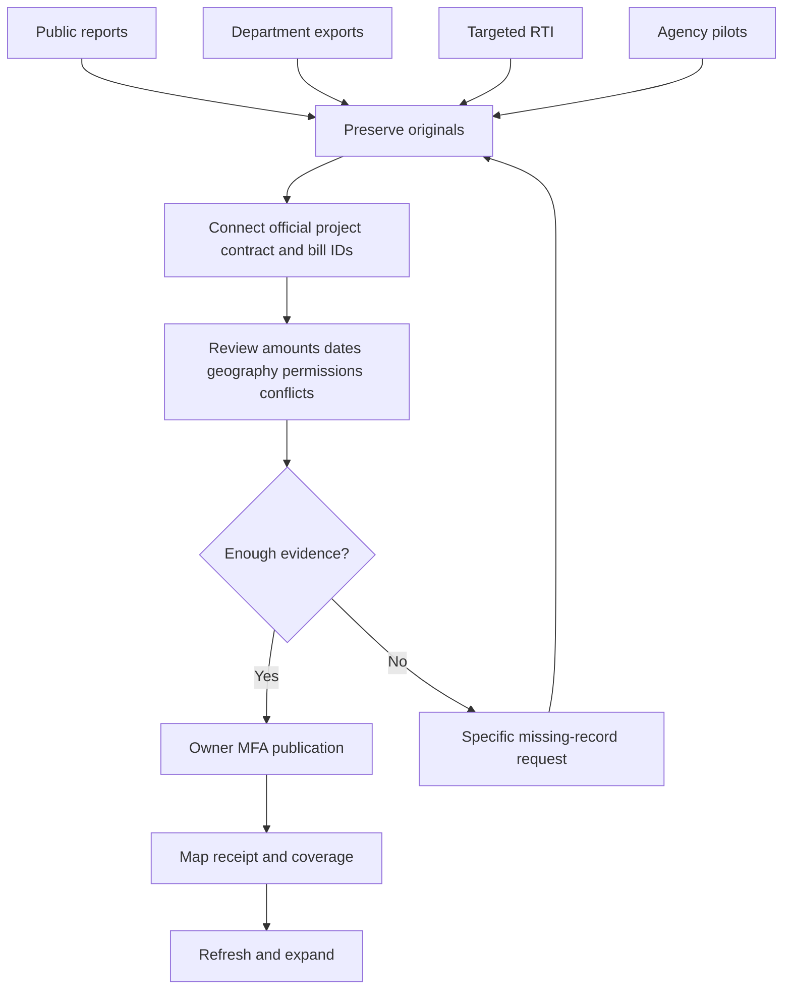

# Hisaab: obtain verified project spending data

Accepted 7 October 2026. This is the working roadmap, not a claim of nationwide financial coverage.

## Goal

Clickable project dots explain location, purpose, sanction, contract, actual allocated payments, dates, business recipient and available completion evidence, each with original source receipts. Start with ten Odisha roads, then 7,161 proposed geography matches; select the strongest-evidenced panchayat rather than inventing a pilot area.

## Four concurrent acquisition routes

1. **Public reports:** inspect OMMAS sanction/agreement/expenditure/payment reports for the ten roads and implementing units. Seek official bill-to-road IDs, verify units and preserve conflicting editions. Investigate nine-parent/ten-row discrepancy. Assess up to five eGramSwaraj panchayats with activity, location and voucher links for FY 2025–26 and FY 2026–27. Prefer Odisha on equal evidence. Source access/reuse restrictions are explicit blockers.
2. **Department exports/APIs:** NRIDA and eGramSwaraj requests sent. Seek small official samples before nationwide exports, with stable IDs, allocation splits, units, revisions, net/gross definitions, recipients, status/reversals, completion references, coverage and reuse terms. Check replies when acquisition resumes; follow up after seven working days; escalate after fourteen without a usable route. Verify office holidays before sending. No automatic outbound follow-up is scheduled; acquisition continuation runs separately.
3. **Targeted RTI:** request existing records for the ten named roads and later selected panchayat activities. Identify current custodian/PIO and correct central/state route. Prepare exact record lists rather than broad demands. Owner provides applicant information, submits and pays applicable fees. Track registration, responses and appeals as separate factual steps.
4. **Agency partnerships:** propose a small named-project pilot to relevant implementing units and panchayat accounting/engineering staff. Verify official contacts and obtain authorization for new messages. Seek registers, locations, bill allocations, payment definitions, completion evidence, reuse terms, update cadence and correction contact. Informal assurances do not replace evidence.

## Workflow

## Evidence and implementation rules

- Preserve original bytes, hash, retrieval time, source filters, field meanings and permission evidence privately.
- Official IDs or documented allocations establish links; similar names, dates or nearby points are suggestions only.
- Never replace actual project geography with a district centre.
- Distinguish sanction, contract, cumulative expenditure, government transfers and individual payments.
- Deduplicate stable transactions, retain revised editions, quarantine conflicts, apply documented reversals and attribute only allocated project shares.
- Record source payment identity, allocation evidence, gross/net basis, recipient, reporting cutoff and per-record review status.
- Explicitly distinguish reported physical completion from completion certificates.
- Publication must preserve unreconciled/missing evidence and require individual reviewed decisions; no automatic approval of all money or pending stages.
- The in-app Evidence progress view has four lanes, task owner/status/blocker/next action/follow-up/supporting record, project checklists and milestones. Public summaries exclude correspondence and private evidence; owner MFA protects details.

## Milestones

| Gate | Acceptance                                                                      |
| ---- | ------------------------------------------------------------------------------- |
| M1   | Four-lane tracker and holdings visible in app                                   |
| M2   | Ten road dossiers, selected panchayat and specific missing-record requests      |
| M3   | First reviewed map location with officially allocated payment, date and sources |
| M4   | Ten complete evidence-chain cards; unavailable completion certificates labelled |
| M5   | Repeat imports update without duplicate payments or loss of prior evidence      |
| M6   | Wider state/year collection with truthful financial coverage                    |
| M7   | Other sectors, hosted evidence/geography, reviewed GitHub upload and deployment |

Partial projects may be published honestly; they do not count as complete. Authority response times and data completeness are not guaranteed. Historical assets stay optional and separate.

## Current acquisition sequence — updated 7 October 2026

The Chandanbhati monthly cashbook is a sample, not a nationwide endpoint. Public NIC-documented planning, technical approval, administrative approval and physical-progress services successfully returned three plan-year partitions (2024–25, 2025–26, 2026–27). Preserve and join by official activity code. The current returned records total 436 planning activity-year rows, 63 technical and 60 administrative approval rows; 36 activity-year records have reported upload geotags. These are not contractor payments or independently verified locations.

1. Review the drain's CR 04 / activity 122313690 match using number, year, detailed description and original cashbook; resolve gross/net, contract and recipient roles. Validate source geotags before owner publication.
2. Obtain the office's CR 20 mapping; activity 100979008 is only a candidate. Resolve voucher P/35's 1,000 difference.
3. Confirm current documented service scope and supported collection limits before broad collection. FY 2025–26 public report lists 111 activities; API returns 100, with all eleven report-only entries Activity Created. Keep both editions and scope labels.
4. Assess up to four additional panchayats using official local-body codes and the same evidence checklist; compare project-linked voucher access, not just planning-record counts. Chandanbhati is a working sample candidate until this assessment establishes the best accessible pilot.
5. Continue the ten-road allocation/units/conflict review and all pending department requests concurrently. Ask for supported voucher/payment exports; the downloaded v3.0 document does not establish a current individual-payment API.
6. Use the specific RTI and pilot drafts to obtain gaps if public services cannot supply them. Verify current custodian and applicant details; owner handles filing and fees. No new outreach sent or automatic reminders created.

Public progress and blockers remain in Spending → Evidence progress; private normalized responses and candidate joins are excluded from public spending totals.

## Public-source extension discovered during payment verification

Odisha PPMS exposes an official project-linked IFMS bill report: https://ppms.odisha.gov.in/report/ifms-transaction?block=Balangir&district=Balangir&state=Odisha . On 7 October, four observed pagination pages returned 158 distinct project/bill records across 25 panchayats, including 15 for Chandanbhati. The report contains project code, financial year, scheme, bill and bill-serial references, Total Expenditure Amount and treasury status. Source status counts: 146 Bill successful from treasury, 10 processed successfully (two capitalization variants), 2 Failed. Statuses are not independently confirmed bank settlements. No payment dates, payee fields or gross/net definitions appear in this table. Privacy policy does not establish a reuse grant.

Use this as an additional Route A source for the five-panchayat assessment. Follow official project/bill links, verify units and statement cutoff, seek payment-register details and check reuse basis. Use PPMS project codes within PPMS; do not connect to eGramSwaraj activity IDs by name/proximity alone. Do not treat the failed facility-centre bill as a payment or confuse that facility centre with office maintenance.

The eGramSwaraj activity-expenditure search omits Chandanbhati from its FY 2025–26 Balangir selector. Record the accessible-report limitation; do not substitute another panchayat or manipulate hidden filters. Continue permitted sources and targeted custodian requests.

## Verification

Test exact units and decimals, duplicates/revisions/conflicts, split allocations/reversals/transfers, name-only/proximity rejection, missing fields, explicit publication approvals, MFA/private originals, map selection, full coverage counts and repeat imports/outages. Free acquisition is the default. No paid access, RTI fees or new external messages are assumed authorized.

### PPMS project evidence update — 7 October 2026

The filtered Balangir geotag report yielded 477 project rows across ten observed report pages. Exact official project codes connect 155 of the 156 treasury-bill projects; one project has no collected detail. Five candidates across Chandanbhati, Baidipali, Barapudgia, Barkani and Bhundimuhan now have private project/bill/location dossiers available inside Spending, protected by owner MFA. These are candidates, not approved payment cards. Source photo dates and final bill dates do not establish payment dates; executants do not establish recipients. Amount units, gross/net basis, payment dates, confirmed recipients, completion certificates and reuse terms remain unresolved. The filtered report is not a full project catalogue.

Five observed bill-linked payment-detail downloads now provide cheque dates/numbers and cheque amounts. Originals and beneficiary banking/phone columns are private. Two cheque amounts differ from report bill amounts; allocation semantics need reconciliation. These are cheque records, not verified settlement. Owner-only Spending dossiers display safe cheque fields and the discrepancy flags. The PPMS sample/export/reuse request was explicitly authorized and sent 7 October 2026; response pending.

### Reconciliation and wider collection — 7 October 2026

Twenty observed statewide PPMS report pages now contain 974 distinct bill identities across 911 project codes and all 30 Odisha districts, with no differing editions in this batch. This is partial statewide coverage, overlaps the Balangir pilot and is not a nationwide payment total. Saved observed links support the next bounded batch.

Five cheque PDFs were checked for safe recipient extraction and layout. Chandanbhati has one bill/cheque/recipient-total match. Two PDFs clip their amount column and have cheque/bill amount differences; individual recipient amounts remain unavailable. Two other beneficiary sums differ from cheques by 0.05 and 0.01 source units; these are explicit discrepancies, not silently rounded away. The pilot detail dialog reports seven recipient statuses as Success and specifies Contingency, Royalty, EMF, DMF, Empty Gunny Bag and Labour Cess components; the AE/JE recipient has no component classification. These source-reported statuses do not establish independently verified settlement or ultimate contractor identity. Bank/phone columns are excluded from the card response.

All five source geotag pages carry exact project codes. Reported points have maximum spreads between 14.6 and 41.9 metres; this establishes internal proximity only. Their actual source headings are Before and During; no certificate-backed completion or After stage was acquired. Route/site accuracy remains pending.

Ten road source editions are now tabulated in the RTI annex without treating the earlier unverified unit as rupees/lakh or overwriting eight differing figures. Official RTI disclosures identify Balangir Panchayat Samiti as the panchayat public authority and PMGSY/OSRRA within Rural Development as a suggested road-account custodian. Individual incumbent entries may be historic; confirm contact at filing. No RTI or new partnership outreach has been submitted.
